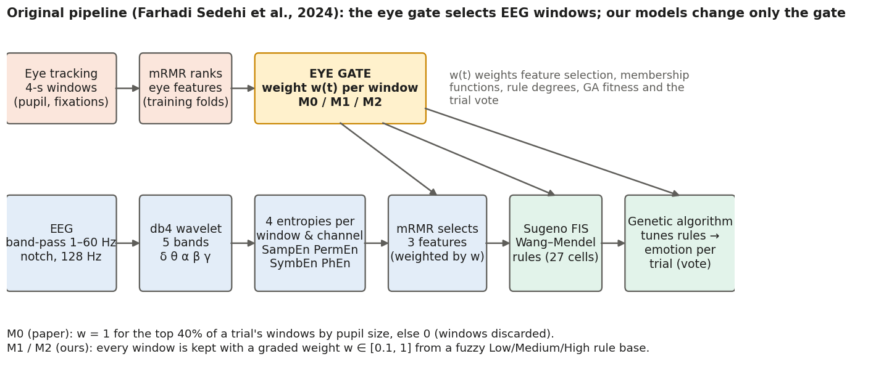
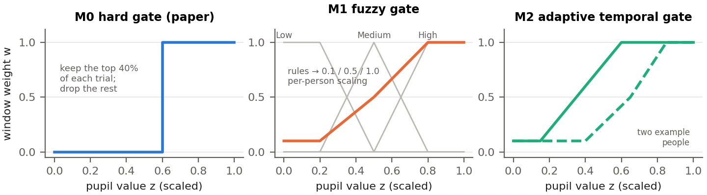
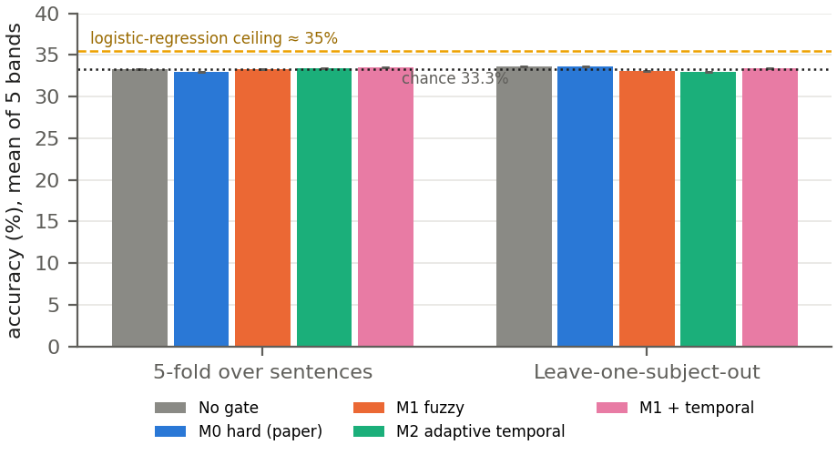
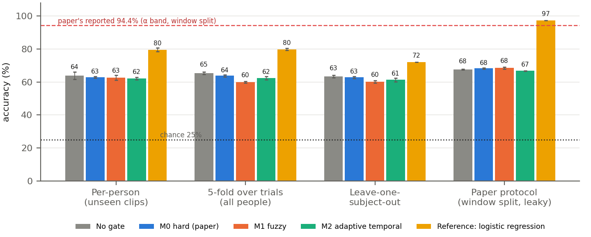
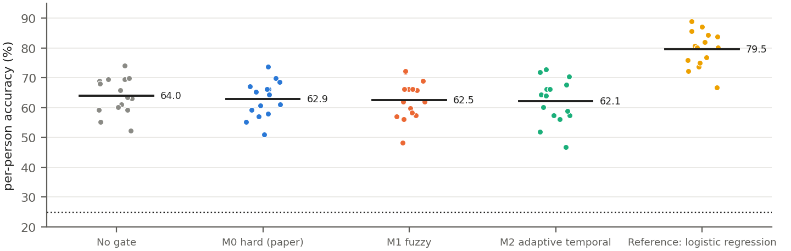

# Final Project Report: Fuzzy Eye-Tracking Gates for Entropy-Based Fuzzy EEG Emotion Recognition

**Soft Computing Project, November 2026.** This file covers the whole project: problem statement, original architecture, our changes, implementation, datasets, the defects we found, all results (ZuCo 1.0 and SEED-IV), conclusions and how to reproduce everything.
**Formal report (PDF):** [`manuscript/final_project_report/main.pdf`](manuscript/final_project_report/main.pdf)

---

## Contents
1. [Summary](#1-summary)
2. [Problem statement](#2-problem-statement)
3. [The original method (baseline paper)](#3-the-original-method-baseline-paper)
4. [Our changes](#4-our-changes)
5. [Implementation](#5-implementation)
6. [Datasets](#6-datasets)
7. [Evaluation protocols](#7-evaluation-protocols)
8. [Defects found and fixed](#8-defects-found-and-fixed)
9. [Results: ZuCo 1.0](#9-results-zuco-10)
10. [Results: SEED-IV](#10-results-seed-iv)
11. [Discussion](#11-discussion)
12. [Limitations](#12-limitations)
13. [Conclusion and future work](#13-conclusion-and-future-work)
14. [Reproducing everything](#14-reproducing-everything)
15. [Project timeline](#15-project-timeline)
16. [References](#16-references)

---

## 1. Summary

- **What we did.**
  - Re-implemented the eye-gated fuzzy EEG emotion recogniser of Farhadi Sedehi et al. (IEEE Access 2024). No official code exists.
  - Proposed two fuzzy eye gates:
    - **M1:** a fuzzy Low/Medium/High pupil gate;
    - **M2:** an adaptive temporal fuzzy gate.
  - Compared them with the paper's **hard gate (M0)** on two real EEG + eye-tracking datasets, using a CPU pipeline (`gfer/`) and a GPU pipeline (`gpu_seed/`, PyTorch/CUDA).
- **ZuCo 1.0** (12 people, 4,430 sentences, text sentiment): every model is at chance, about 33%. Even a logistic regression reaches only about 35%, so ZuCo cannot tell the gates apart.
- **SEED-IV** (15 people × 3 sessions, 1,080 film clips, 4 emotions):
  - All models are far above chance (25%). Per-person models on unseen clips reach **62–64%** with the fuzzy classifiers and **79.5%** with a logistic-regression reference.
  - **The fuzzy gates do not beat the hard gate:**
    - M1 and M2 are 0.3–3.8 points below M0.
    - M1 is significantly worse in one protocol (−3.8 points, p = 0.017).
    - Using **no gate at all** is as good as or better than any gate.
- **Why the paper reports 94%.** The paper's window-level split puts windows of the same clip in both training and test. Under that split our reference model scores **97.4%**, against **79.5%** when whole clips are held out. The published number is mostly a property of the evaluation protocol.
- **What the project delivers:**
  - a verified, reproducible implementation, with 16 tests confirming the GPU code reproduces the reference;
  - 8 real defects found and fixed;
  - an honest negative result for fuzzy gating;
  - a quantified explanation of the gap between published and realistic accuracy.

---

## 2. Problem statement

EEG emotion recognition is noisy: not every second of a recording reflects the emotion being studied. The baseline paper uses **eye tracking** to choose which EEG windows to trust. It keeps windows where pupil size (an arousal marker) is high and discards the rest.

That **hard threshold** has three problems:
- it throws away most of the data (60% of windows);
- it has no notion of "partially relevant";
- its cut-off is the same for everyone, although pupils differ between people.

**Objectives**
1. Re-implement the baseline pipeline.
2. Replace the hard gate with **fuzzy gates** that weight every window by graded relevance (M1, M2).
3. Evaluate on **real** data with **leakage-free** protocols, and test whether the fuzzy gates improve accuracy.

**Scope decision.** The earlier plan also had M3 (multi-band probability fusion) and M4 (M2 + M3). These were removed so that the **eye gate is the only difference between models**.

---

## 3. The original method (baseline paper)

**Paper:** Farhadi Sedehi J, Jafarnia Dabanloo N, Maghooli K, Sheikhani A (2024). *Recognition of emotional categories using mined fuzzy rules from electroencephalogram signals with gated eye track data approach.* IEEE Access 12:118122–118140.



| Stage | What the paper does |
|---|---|
| Eye features | 8 per 4-s window: fixation duration (mean, SD, max), fixation frequency, pupil diameter X/Y (mean, SD) |
| Eye ranking | mRMR; **mean pupil diameter (Y)** ranks first |
| Gate (M0) | The maximum of that pupil feature is the threshold; only EEG windows at high pupil values are kept |
| EEG preprocessing | band-pass filter, resample to 128 Hz |
| Bands | db4 wavelet → δ, θ, α, β, γ |
| Features | 4 nonlinear entropies per window and channel: SampEn, PermEn, SymbEn, PhEn (m = 5, τ = 2) |
| Feature selection | mRMR → 3 features (reported: PhEn-FP2, SampEn-T8, PermEn-T7) |
| Classifier | zero-order Sugeno FIS, 3 levels per input (27 rule cells); rules from a lookup table (Wang–Mendel) |
| Rule tuning | genetic algorithm (population 27) |
| Evaluation | 5-fold cross-validation over **pooled 4-s windows**, one classifier per band |
| Reported accuracy | **SEED-IV:** α 94.42%, β 93.02%, γ 89.80% · **MAHNOB-HCI:** α 85.20%, β 82.92%, γ 79.05% |

---

## 4. Our changes

### 4.1 The three eye gates (only the gate differs between models)



| Model | Gate | Window weight |
|---|---|---|
| **No gate** | reference | w = 1 for every window |
| **M0 (paper)** | hard threshold | w = 1 if the pupil value is in the top 40% of its trial, else 0 (window dropped) |
| **M1 (ours)** | fuzzy Low/Medium/High | Pupil value scaled to [0, 1] per person or session (P5–P95); triangular memberships (0.2 / 0.5 / 0.8); three rules output 0.1 / 0.5 / 1.0; Sugeno weighted average. **Every window is kept.** |
| **M2 (ours)** | adaptive temporal fuzzy | Like M1, but (a) missing values are interpolated, (b) the Low/Medium/High breakpoints are **each person's own** 20th/50th/80th percentiles, and (c) weights are **smoothed** over neighbouring windows (t−1, t, t+1). A causal variant uses only (t−1, t). |
| M1 + temporal (ZuCo) | combination | M1 followed by M2's smoothing |

- **Label-free:** all gates use only the eye signal, never the emotion labels.
- **Gate feature:** chosen by mRMR on the training fold, as in the paper.
- **Where the weights act:** in **every learning step**, not only by dropping windows:
  - weighted mRMR feature selection;
  - membership-function fitting;
  - Wang–Mendel rule degrees;
  - GA fitness;
  - the trial-level vote: ŷ = argmax_c Σ_t w_t P_t(c) / Σ_t w_t.

### 4.2 Evaluation changes
- **Leakage-free protocols:** whole trials, or whole people, are held out (see §7). The paper's window split is kept only for comparison.
- **Training data only:** every label-dependent step is fitted on the training fold.
- **Statistics:** 3 seeds; significance tests (binomial against chance, McNemar, Wilcoxon over people).

### 4.3 The "improved" preset for SEED-IV
These are standard, honest accuracy improvements, fixed in advance and applied to every model:
- **Per-person models** (`within`), the standard SEED-IV setting;
- the dataset's own **DE features** (`eeg_feature_smooth`), alongside the 4 entropies;
- **eye features as classifier inputs**, not only for gating;
- **all 5 bands pooled** into one feature set;
- **4 fuzzy inputs** instead of 3;
- **class-balanced training** (balanced-accuracy GA fitness, class weights);
- a **logistic-regression reference** on all features, to show the ceiling.

---

## 5. Implementation

| Part | Where | What |
|---|---|---|
| Core pipeline (CPU) | `gfer/` | preprocessing, wavelets, entropies, mRMR, Sugeno FIS, GA, evaluation |
| ZuCo loader | `gfer/zuco.py` | sentence = trial, label alignment verified, 10–20 channel subset |
| Gates | `gfer/gates.py`, `gfer/adaptive_gate.py` | M0, M1, M2 (shared by both pipelines) |
| ZuCo experiments | `gfer/compare.py`, `gfer/summarize.py` | runs and reports |
| GPU pipeline | `gpu_seed/` | PyTorch/CUDA: batched entropies, mRMR, GA population scoring; SEED-IV layout discovery; parallel and resumable |
| Tests | `tests/` | 16 tests; the GPU code reproduces the NumPy reference exactly |

**Run on:** NVIDIA RTX 4070 Laptop GPU (Windows 11, Python 3.14, PyTorch 2.11 + CUDA 12.8).
- SEED-IV feature extraction: about 37 min in total, over two attempts.
- The 60 experiments: 20 min.

---

## 6. Datasets

| | ZuCo 1.0, task 1 | SEED-IV |
|---|---|---|
| Stimulus | reading movie-review sentences | watching emotional film clips |
| Label | text sentiment (negative / neutral / positive), **not the reader's emotion** | induced emotion (neutral / sad / fear / happy) |
| People and trials | 12 people; 4,430 sentences (2–30 s) | 15 people × 3 sessions; 1,080 clips (roughly 1.5–4 min) |
| EEG | EGI 128-channel net; 19 channels at 10–20 positions; 500 → 128 Hz | 62 channels; 200 → 128 Hz |
| Eye data | EyeLink pupil area, fixations | 31 features per 4-s window |
| Windows | 1 s (23,683) | 4 s (37,575) |
| Chance | 33.3% | 25% |
| Checks done | sentence/label alignment verified on all 46 control markers | 15 subjects × sessions [1, 2, 3]; 200 Hz; labels identical to the dataset's ReadMe |

---

## 7. Evaluation protocols

| Protocol | What is held out | Notes |
|---|---|---|
| **Per-person** (`within`, SEED-IV) | for each person, 5-fold over their 72 trials | test clips are new to that person's model; the cleanest estimate |
| **5-fold over trials** | whole trials; all people pooled | |
| **Leave-one-subject-out (LOSO)** | one whole person | the test person is never seen |
| **Paper protocol** (SEED-IV) | random 4-s windows | **leaky:** windows of the same clip appear in both train and test; for comparison with the paper only |

All results are the **mean ± SD of 3 seeds**.

---

## 8. Defects found and fixed

The pipeline was first built on synthetic data. Running it on real data exposed these problems. Every fix applies identically to all models, and each was chosen from diagnostics, never from test accuracy.

| # | Problem | Evidence | Fix |
|---|---|---|---|
| 1 | Entropy settings unusable on 1-s windows (ZuCo) | SampEn returned a constant in 57–94% of α/β/γ windows | m = 3, τ = 1; SampEn m = 2 (SEED-IV keeps the paper's m = 5, τ = 2 on 4-s windows) |
| 2 | Flat reference channel used as a feature | Cz (EGI reference, SD = 0) was chosen by mRMR in almost every fold | constant features excluded; Cz dropped |
| 3 | GA collapsed to one rule | "always neutral" maximised accuracy + coverage | balanced-accuracy fitness |
| 4 | Smallest class got no rules | Wang–Mendel gave 26 of 27 cells to the larger classes | class-balanced training weights |
| 5 | M1 v1 was a copy of M0 | per-sentence scaling gave weight correlation r = 0.81 with M0 | per-person scaling (r = 0.28) |
| 6 | Old M2 baseline had no effect | per-person baseline cancelled by per-trial rescaling | M2 rewritten |
| 7 | Unreadable ZuCo file | ZMG block 1 is MATLAB v5, not v7.3 | fallback reader |
| 8 | GPU-laptop crashes | Windows text encoding; 1.5 GB inter-process messages; no CUDA wheel for Python 3.14 on cu124 | UTF-8 output; temporary files; cu128 PyTorch build |

Early ZuCo numbers (35–38%) shown before fixes 2–4 were inflated, because the models mostly predicted the majority class. They are marked **OUTDATED** in the repository.

---

## 9. Results: ZuCo 1.0



**Accuracy (%), mean of the 5 bands and 3 seeds (chance 33.3%)**

| Protocol | No gate | M0 | M1 | M2 | M1 + temporal | Logistic-regression reference |
|---|---|---|---|---|---|---|
| 5-fold over sentences | 33.3 | 33.0 | 33.3 | 33.4 | 33.5 | 35.2 |
| Leave-one-subject-out | 33.7 | 33.6 | 33.1 | 33.0 | 33.4 | 35.5 |

**Each proposed gate minus M0** (15 band × seed runs; runs where the gate beat M0 in brackets)

| | M1 | M2 | M1 + temporal |
|---|---|---|---|
| 5-fold | +0.32 (11/15) | +0.44 (10/15) | +0.47 (13/15) |
| LOSO | −0.52 (4/15) | −0.62 (3/15) | −0.23 (7/15) |

- **No overall difference is significant** (Wilcoxon over people, all p > 0.1).
- **Why ZuCo can't test the gates:** it labels the sentiment of the **text**, not an emotion felt by the reader, and its features carry almost no sentiment information.
- **What ZuCo was useful for:** debugging and verifying the pipeline on real data.
- **Full ZuCo details:** `PROJECT_SUMMARY.md`, `manuscript/zuco_report/main.pdf`, `results/zuco_*`.

---

## 10. Results: SEED-IV



**Accuracy (%), mean ± SD over 3 seeds** (chance 25%; features: DE + 4 entropies + eye, all bands, 4 fuzzy inputs)

| Protocol | No gate | M0 hard | M1 fuzzy | M2 adaptive | Logistic-regression reference |
|---|---|---|---|---|---|
| **Per-person (unseen clips)** | **64.0 ± 2.2** | 62.9 ± 0.5 | 62.5 ± 1.4 | 62.1 ± 0.7 | 79.5 ± 1.2 |
| 5-fold over trials | **65.4 ± 0.7** | 63.8 ± 0.6 | 59.9 ± 0.5 | 62.3 ± 1.0 | 79.8 ± 0.6 |
| Leave-one-subject-out | **63.3 ± 0.7** | 62.8 ± 0.6 | 60.2 ± 0.7 | 61.3 ± 1.1 | 72.0 ± 0.0 |
| Paper protocol (window split, leaky) | 67.6 ± 0.4 | 68.2 ± 0.3 | **68.4 ± 0.7** | 66.7 ± 0.2 | 97.4 ± 0.0 |
| *Paper's reported result (α band, window split)* | | *94.42* | | | |

**Proposed gates minus M0 (points)**, with the McNemar test (seed 0) and, for LOSO, the Wilcoxon test over the 15 people

| | Per-person | 5-fold trials | LOSO | Paper protocol |
|---|---|---|---|---|
| M1 − M0 | −0.34 (p = 0.37) | **−3.83 (p = 0.017)** | −2.65 (p = 0.12; Wilcoxon 0.37; 5/15 people helped) | +0.24 |
| M2 − M0 | −0.77 (p = 0.67) | −1.48 (p = 0.62) | −1.54 (p = 0.18; Wilcoxon 0.35; 6/15 helped) | −1.45 |

**Per-class recall (%), per-person protocol**

| Model | Neutral | Sad | Fear | Happy |
|---|---|---|---|---|
| No gate | 74.9 | 56.3 | 77.4 | 47.2 |
| M0 hard | 71.9 | 55.2 | 77.0 | 47.4 |
| M1 fuzzy | 80.2 | 54.8 | 72.3 | 42.7 |
| M2 adaptive | 79.6 | 54.8 | 71.7 | 42.2 |
| Logistic-regression reference | 90.6 | 75.1 | 81.4 | 71.0 |



**Other facts from the run**
- **Spread between people** (per-person protocol): 47–74% for the fuzzy models and 67–89% for the reference. That is far larger than the differences between gates.
- **Rule-base size:** 29–48 rules after the GA.
- **Features the fuzzy models chose:**
  - per person: about 40% DE, 35% eye, 25% entropy;
  - with people pooled: **only DE and eye features**, never the paper's entropies.
- **Gate feature:** eye feature column 0 in 56% of folds. SEED-IV's 31 eye features are unnamed.

**Findings**
1. **The fuzzy pipeline works on real emotion data:** 60–68% on four classes, with 4 inputs and readable rules.
2. **Gating does not help.** No gate ≥ M0 ≥ M1/M2 under all honest protocols. The only significant difference favours M0. The fuzzy gates shift recall toward "neutral" at the cost of "sad" and "happy".
3. **The fuzzy classifier is capacity-limited.** The logistic regression is 15–17 points higher.
4. **The paper's 94% comes from the window split.** The same reference model drops from **97.4%** under the window split to **79.5%** when whole clips are held out.

---

## 11. Discussion

- **Why gating fails here.** A gate helps only if the windows it down-weights carry less class information than those it keeps. On SEED-IV every window of a clip is about equally informative (no gate is best), so dropping or down-weighting windows removes evidence, not noise. Pupil size also tracks screen **luminance**, which differs between clips, so "high pupil" is not a reliable marker of emotional windows.
- **What the fuzzy gates still offer.** They keep every window, replace an arbitrary cut-off with an interpretable three-rule system, and adapt to each person. The cost is within one point of M0 per person.
- **A cross-person confound.** Every SEED-IV participant watched the same clips in the same order. In the 5-fold-over-trials and LOSO protocols, the test clip has been seen, from other people, during training. Stimulus-driven features, especially eye features, can then recognise the clip. That plausibly explains why the reference model still gets 72% across people; we could not test this directly. **The per-person protocol (unseen clips) is the cleanest estimate.**

---

## 12. Limitations

- **SEED-IV used only the improved preset.** The paper-faithful preset (entropies only, 3 inputs, one band at a time) is implemented (`python -m gpu_seed --root <dir>`) but was **not run**, so there is no per-band replication of the paper's 94.4%.
- **SEED-IV's eye features are unnamed** (identified by column index only).
- **Gate parameters were fixed, not tuned,** and we used 3 seeds.
- **ZuCo is not an emotion dataset.**

---

## 13. Conclusion and future work

We re-implemented the eye-gated fuzzy EEG pipeline, verified it on two real datasets, proposed fuzzy (M1) and adaptive temporal (M2) gates, and evaluated them rigorously.
- On SEED-IV the fuzzy classifiers recognise four emotions far above chance: **62–64% per person on unseen clips**.
- **Neither proposed gate beats the paper's hard gate, and gating itself does not beat using all windows.**
- The paper's 94% is reproduced only under its leaky window-level split.

**Future work**
- Use the fuzzy gate for interpretability rather than accuracy.
- Close the gap to the 79.5% reference with more fuzzy inputs or hierarchical rule bases.
- Run the paper-faithful SEED-IV preset.
- Correct the pupil signal for screen luminance.

---

## 14. Reproducing everything

```bash
pip install -r requirements.txt

# ZuCo (CPU)
python scripts/download_zuco.py --out data/zuco --jobs 6
python -m gfer.zuco --src data/zuco --out data/zuco_npz
python -m gfer.compare --datasets data/zuco_npz --protocols trial,loso --seeds 0,1,2 \
       --variants none,hard,fuzzy,fuzzy_trialnorm --out results/zuco_final_m0m1
python -m gfer.compare ... --variants adaptive,adaptive_nosmooth,adaptive_causal --out results/zuco_m2/m2_only
python -m gfer.compare ... --variants fuzzy_smooth --out results/zuco_combo/combo_only

# SEED-IV (GPU; branch seed-iv-gpu; see gpu_seed/README.md)
pip install torch --index-url https://download.pytorch.org/whl/cu128
pip install -r gpu_seed/requirements.txt
python -m gpu_seed --root "<SEED-IV folder>" --preset improved     # results: gpu_seed/results/improved
python -m gpu_seed --root "<SEED-IV folder>"                       # paper-faithful preset (not yet run)

# Final report figures and numbers
python manuscript/final_project_report/make_figures.py
```

| What | Where |
|---|---|
| **Final report (PDF)** | `manuscript/final_project_report/main.pdf` (source `main.tex`, numbers in `seed_stats.json`) |
| SEED-IV results | `gpu_seed/results/improved/` (`report.md`, `summary.csv`, `tasks/*.json`, `log.txt`), plus `gpu_seed/results/dataset_inventory.txt` |
| ZuCo results | `results/zuco_final_m0m1/`, `results/zuco_m2/`, `results/zuco_combo/`; report `manuscript/zuco_report/main.pdf` |
| ZuCo-only summary | `PROJECT_SUMMARY.md` |
| GPU run guide | `gpu_seed/README.md` |
| Outdated material | `results/zuco_subset_m0m1/` (pre-fix), `manuscript/final_report/` and `manuscript/springer_paper/` (earlier synthetic M0–M4 drafts), `results/01_Implemented_Model/` (synthetic) |

---

## 15. Project timeline

1. **Synthetic-data prototype** of M0–M4 (earlier drafts; synthetic results, not real-data evidence).
2. **Scope cut** to M0 and M1, then M2. M3 and M4 removed.
3. **ZuCo 1.0:**
   - download and loader;
   - 8 defects found and fixed;
   - M0/M1, M2 and M1 + temporal evaluated; all at chance (§9).
4. **SEED-IV:**
   - GPU pipeline written and tested;
   - run on an RTX 4070 laptop with the improved preset;
   - results in §10.
5. **This final report.**

---

## 16. References

- Farhadi Sedehi J, Jafarnia Dabanloo N, Maghooli K, Sheikhani A (2024). Recognition of emotional categories using mined fuzzy rules from electroencephalogram signals with gated eye track data approach. *IEEE Access* 12:118122–118140. https://doi.org/10.1109/ACCESS.2024.3430934
- Zheng WL, Liu W, Lu Y, Lu BL, Cichocki A (2019). EmotionMeter: a multimodal framework for recognizing human emotions. *IEEE Trans Cybern* 49(3):1110–1122 (SEED-IV). https://doi.org/10.1109/TCYB.2018.2797176
- Hollenstein N, Rotsztejn J, Troendle M, Pedroni A, Zhang C, Langer N (2018). ZuCo, a simultaneous EEG and eye-tracking resource for natural sentence reading. *Sci Data* 5:180291. https://doi.org/10.1038/sdata.2018.291
