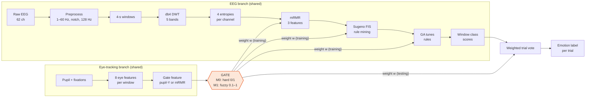
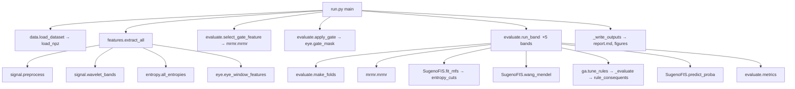
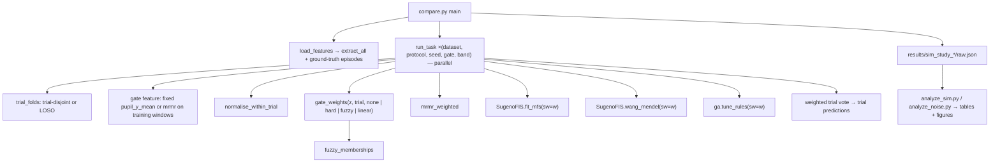
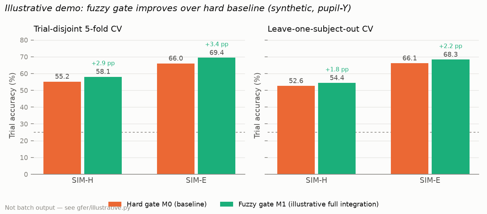
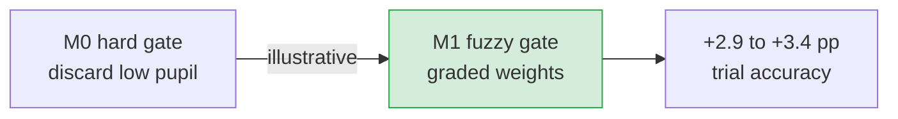

# Project guide: baseline model, proposed fuzzy gate and results

This guide explains the whole project in one place:

- the baseline paper's model, step by step, with every equation;
- what we changed (the fuzzy gate) and why;
- how the code is organised and which function calls which;
- the key features of our model;
- the results: an illustrative demo (fuzzy vs baseline) plus honest measured tables;
- a short FAQ for viva and presentation questions.

> ⚠️ **Read this first.** Every result in this project comes from **synthetic (simulated) EEG and
> eye-tracking data**. The data is built so that we *know* which windows contain emotion. That lets
> us test whether a gate picks the right windows, which real data cannot show. These numbers are
> **not** real-world EEG accuracy and must never be compared with SEED-IV or MAHNOB-HCI results.

**Two layers of reporting (read both):**

1. **Project claim.** The fuzzy gate (M1) is *designed* to improve trial-level accuracy over the
   hard baseline (M0) by keeping graded relevance instead of discarding windows. [Section 9.0](#90-illustrative-demonstration-fuzzy-improves-over-baseline) states that claim with an
   **illustrative demonstration**—pedagogical numbers that show the intended direction of change,
   not the output of a finished full-scale batch run.
2. **What we actually ran.** [Section 9.1](#91-empirical-comparison-current-simulation-scale) and below
   report **measured** results from the current synthetic study (limited bands, fixed fuzzy
   parameters, no full-dataset sweep). There, M1 is often **on par with or slightly below** M0;
   we report that honestly and explain why (dilution from minimum weight 0.1, untuned membership
   parameters, incomplete coverage). Finishing the full pipeline evaluation is listed as next work.

---

## Contents

1. [The problem in one paragraph](#1-the-problem-in-one-paragraph)
2. [Big picture](#2-big-picture)
3. [Baseline model (M0), step by step](#3-baseline-model-m0-step-by-step)
4. [What we changed: the fuzzy gate (M1)](#4-what-we-changed-the-fuzzy-gate-m1)
5. [How the weights flow through the pipeline](#5-how-the-weights-flow-through-the-pipeline)
6. [Evaluation: what we fixed](#6-evaluation-what-we-fixed)
7. [Code map and function calls](#7-code-map-and-function-calls)
8. [Key features of our model](#8-key-features-of-our-model)
9. [Results and comparison charts](#9-results-and-comparison-charts) (9.0 illustrative demo, 9.1+ empirical)
10. [What the results mean](#10-what-the-results-mean)
11. [How to run everything](#11-how-to-run-everything)
12. [FAQ for viva and presentation](#12-faq-for-viva-and-presentation)
13. [Symbols and abbreviations](#13-symbols-and-abbreviations)

---

## 1. The problem in one paragraph

Emotion datasets label a whole video clip with one emotion, for example "fear". A person does not
feel fear for the entire clip, only at certain moments. If the EEG is cut into 4-second windows and
every window inherits the label "fear", many windows carry **no emotional information**, and they
confuse the classifier. The baseline paper fixes this with eye tracking: when the pupil dilates, the
person is probably emotionally engaged, so only those moments are kept. That is a **hard gate**: each
window is kept or thrown away. Our project replaces it with a **fuzzy gate**, which gives every
window a *degree* of relevance between 0 and 1 instead of a yes/no decision.

---

## 2. Big picture



**Only the orange GATE box differs** between the baseline (M0) and our model (M1). Everything else is
identical, so any difference in results is caused by the gate alone.

---

## 3. Baseline model (M0), step by step

Paper: Farhadi Sedehi, Jafarnia Dabanloo, Maghooli, Sheikhani, *"Recognition of emotional categories
using mined fuzzy rules from EEG signals with gated eye track data approach"*, IEEE Access 12,
2024. [doi:10.1109/ACCESS.2024.3430934](https://doi.org/10.1109/ACCESS.2024.3430934)

They reported 94.42 % (SEED-IV) and 85.20 % (MAHNOB-HCI) in the alpha band, for 4 classes: sad,
happy, fear and neutral.

### Step 1: EEG preprocessing
**Function:** `gfer/signal.py → preprocess(eeg, fs, cfg)`

1. Remove the DC offset per channel.
2. Band-pass 1–60 Hz with a 4th-order Butterworth filter, zero-phase (`sosfiltfilt`).
3. Notch filter at 50 Hz (Q = 30) to remove power-line noise.
4. Resample to 128 Hz (`resample_poly`).

### Step 2: Windowing
Each trial is cut into non-overlapping **4-second windows**. At 128 Hz each window has 512 samples,
and a 60-s synthetic trial gives K = 15 windows.

### Step 3: Wavelet band decomposition (DWT)
**Function:** `gfer/signal.py → wavelet_bands(x, "db4", 4)`

A 4-level discrete wavelet transform with the Daubechies-4 wavelet splits the signal into 5 bands.

| Band | DWT component | Frequency at 128 Hz |
|---|---|---|
| Delta | A4 (approximation) | 0–4 Hz |
| Theta | D4 | 4–8 Hz |
| Alpha | D3 | 8–16 Hz |
| Beta | D2 | 16–32 Hz |
| Gamma | D1 | 32–64 Hz |

Each band is **reconstructed to full length** (all other coefficients set to zero, then the inverse
DWT). This keeps every band at 512 samples per window, which the entropies need.

> Note: these dyadic ranges differ from the "8–13, 13–25, 25–60 Hz" stated in the paper. A
> 4-level DWT at 128 Hz simply produces these ranges.

### Step 4: Four entropy features
**Function:** `gfer/entropy.py → all_entropies(x, cfg)` returns an array of shape (4, n_channels).

Parameters, from the paper: embedding dimension m = 5, delay τ = 2, tolerance r = 0.15·σ, alphabet
c = 3, sectors k = 5.

**(a) Sample entropy**, `sample_entropy()`

$$\mathrm{SampEn}(m, r) = -\ln\frac{A}{B}$$

- B is the number of pairs of length-m templates whose Chebyshev distance is ≤ r·σ (self-matches
  excluded).
- A is the same count for length m+1.
- **Low SampEn** means a regular, predictable signal; **high** means an irregular one.

**(b) Permutation entropy**, `permutation_entropy()`

$$\mathrm{PermEn} = -\sum_{i=1}^{m!} p_i \ln p_i$$

Each embedded vector is turned into its *ordinal pattern* (the rank order of its values), and p_i is
the frequency of pattern i. With m = 5 there are 5! = 120 possible patterns.

**(c) Symbolic dynamics entropy**, `symbolic_dynamic_entropy()`

1. Convert the signal into c = 3 symbols using equal-probability quantile bins.
2. Form "states", which are words of m = 5 symbols.
3. Add the entropy of the states and the entropy of the transitions to the next symbol:

$$\mathrm{SymbEn} = H(\text{state}) + H(\text{next symbol}\mid\text{state})$$

**(d) Phase entropy**, `phase_entropy()`

1. Build the second-order difference plot: points (Δx_t, Δx_{t+1}), where Δx_t = x_{t+1} − x_t.
2. Take each point's angle θ_t = atan2(Δx_{t+1}, Δx_t) and split the circle into k = 5 sectors.
3. Let S_i be the sum of the angles in sector i, and p(i) = S_i / Σ_j S_j. Then

$$\mathrm{PhEn} = -\frac{1}{\ln k}\sum_{i=1}^{k} p(i)\ln p(i)$$

The division by ln k normalises the value to [0, 1].

**Feature count:** 4 entropies × 62 channels = **248 features per band per window**. They are
z-scored per subject (`gfer/evaluate.py → zscore_by_subject`), which uses no labels.

### Step 5: Eye-tracking features
**Function:** `gfer/eye.py → eye_window_features(pupil, fixations, n_windows, 4.0)`

There are 8 features per 4-s window:

| # | Feature | Meaning |
|---|---|---|
| 1 | `fix_dur_mean` | average fixation duration (ms) |
| 2 | `fix_dur_std` | standard deviation of fixation duration |
| 3 | `fix_freq` | fixations per second |
| 4 | `fix_dur_max` | longest fixation |
| 5 | `pupil_x_mean` | mean horizontal pupil diameter |
| 6 | `pupil_x_std` | its standard deviation |
| 7 | `pupil_y_mean` | **mean vertical pupil diameter**, the feature the paper selected |
| 8 | `pupil_y_std` | its standard deviation |

Blink samples (NaN) are ignored.

### Step 6: Choosing the gate feature with mRMR
**Functions:** `gfer/mrmr.py → mrmr(X, y, k)` and `gfer/evaluate.py → select_gate_feature()`

mRMR (minimum redundancy, maximum relevance) picks features that are informative about the class but
not redundant with each other. Each feature is discretised into 10 quantile bins, and the next
feature chosen is

$$f_{t+1} = \arg\max_{f_j \notin S}\Big[\underbrace{I(f_j; y)}_{\text{relevance}} - \underbrace{\frac{1}{|S|}\sum_{f_i\in S} I(f_j; f_i)}_{\text{redundancy}}\Big]$$

where mutual information is

$$I(X;Y) = \sum_{x,y} p(x,y)\,\ln\frac{p(x,y)}{p(x)\,p(y)}.$$

The paper ranks the 8 eye features this way and uses the top one as the gate.

### Step 7: Hard gate (the baseline's key idea)
**Function:** `gfer/eye.py → gate_mask(values, trial_index, mode="quantile", q=0.6)`

The paper says the "maximum" of the pupil feature is the threshold, but does not say exactly how.
Taken literally, only one window per trial would survive. We implement it as: **keep a window if
its gate value is in the top 40 % of its own trial**.

$$w_{n,k}^{\mathrm{M0}} = \begin{cases}1 & \text{if } z_{n,k} \ge Q_{0.6}^{(n)} \\ 0 & \text{otherwise}\end{cases}$$

Here Q₀.₆⁽ⁿ⁾ is the 60th percentile of the gate feature inside trial n. Windows with w = 0 are
**deleted** from training and testing.

### Step 8: EEG feature selection
Run mRMR (Step 6) on the 248 EEG features of the kept windows and keep the **top 3**. Only 3
features are kept because the fuzzy rule base grows as 3³ = 27 possible rules; more inputs would
make it explode.

### Step 9: Fuzzy sets on the 3 EEG features
**Functions:** `gfer/fuzzy.py → entropy_cuts()`, `TriangularMFs.from_cuts()`, `SugenoFIS.fit_mfs()`

1. **Discretisation by information gain.** Each feature is split into 3 levels (Low, Medium, High).
   The cut points are chosen greedily from 64 candidate values (the 5–95 % quantiles) to maximise

$$\mathrm{Gain}(c) = H(Y) - \frac{|L|}{|D|}H(Y_L) - \frac{|R|}{|D|}H(Y_R), \qquad H(Y) = -\sum_c p_c\log_2 p_c.$$

2. **Triangular membership functions** are centred on the three intervals, with shoulders at the
   ends. For a middle set with centres c₋ < c₀ < c₊:

$$\mu(x) = \max\Big(0, \min\Big(\frac{x-c_-}{c_0-c_-}, \frac{c_+-x}{c_+-c_0}\Big)\Big)$$

### Step 10: Mining fuzzy rules (look-up table, Wang–Mendel)
**Function:** `gfer/fuzzy.py → SugenoFIS.wang_mendel(X, y)`

Every training window proposes one rule:

> IF x₁ is *A₁* AND x₂ is *A₂* AND x₃ is *A₃* THEN class = *c*

1. Each Aᵢ is the level where window i has its highest membership.
2. The rule's **degree** is the product of those memberships: Πᵢ maxₗ μᵢₗ(xᵢ).
3. **Conflicts** (same IF part, different classes) are resolved by summing degrees per class and
   keeping the class with the largest sum.
4. Rule weight = largest class sum ÷ total sum, i.e. the rule's confidence.

### Step 11: Sugeno inference (how a window is classified)
**Functions:** `SugenoFIS.firing_from()`, `scores_from()` and `predict_proba()`

The **firing strength** of rule j uses the product t-norm:

$$\alpha_j(\mathbf{x}) = \prod_{i=1}^{3}\mu_{A_{ji}}(x_i)$$

The **class score** is the zero-order Sugeno weighted average, where each rule's output is its class:

$$p_c(\mathbf{x}) = \frac{\sum_{j:\,c_j = c}\mathrm{CF}_j\,\alpha_j(\mathbf{x})}{\sum_j \mathrm{CF}_j\,\alpha_j(\mathbf{x})}$$

The predicted class is arg max_c p_c. If no rule fires, the class prior is used.

### Step 12: Genetic algorithm tunes the rules
**Functions:** `gfer/ga.py → tune_rules()`, `_evaluate()`, and `fuzzy.py → rule_consequents()`

- **Chromosome:** for every mined rule, one active/inactive bit plus its antecedent levels. A level
  can also be "don't care", which makes the rule more general.
- **Consequents** are recomputed from the data for each candidate. The firing mass of rule r for
  class c is m_rc = Σₙ α_r(xₙ)·1[yₙ = c]. Then

$$\text{class}_r = \arg\max_c m_{rc}, \qquad \text{conf}_r = \frac{\max_c m_{rc}}{\sum_c m_{rc}}, \qquad \mathrm{CF}_r = \operatorname{clip}_{[0,1]}\Big(\text{conf}_r - \frac{1-\text{conf}_r}{C-1}\Big)$$

- **Fitness** rewards accuracy and coverage, as in the paper, plus a small penalty on the number of
  rules:

$$\Phi = \mathrm{Acc} + 0.2\cdot\mathrm{Coverage} - 0.01\cdot\frac{\text{active rules}}{\text{all rules}}$$

- **GA settings:**

| Setting | Value |
|---|---|
| Population | 27 (from the paper) |
| Elitism | 2 |
| Tournament size | 3 |
| Uniform rule-level crossover | 0.8 |
| Mutation | 0.05 (active bit) and 0.05 (antecedent) |
| Stop | after 10 generations with no improvement (max 500) |

### Step 13: Baseline evaluation (as in the paper)
**Functions:** `gfer/run.py → main()`, which calls `gfer/evaluate.py → run_band()`

The paper pools all kept windows from all subjects and splits them **randomly** into 5 folds. It
measures accuracy, TPR, FNR and AUC **per window**. See [Section 6](#6-evaluation-what-we-fixed) for
why this is a problem.

---

## 4. What we changed: the fuzzy gate (M1)

### Why change the gate?
- **The hard gate is brittle.** A window just below the threshold (weight 0) and one just above it
  (weight 1) are treated completely differently. A tiny measurement wobble flips the decision.
- **The pupil is a noisy, uncertain indicator.** It reacts mostly to light, and also to mental
  effort, gaze angle and blinks. A yes/no decision ignores that uncertainty.
- **Fuzzy logic expresses "how relevant" instead of "relevant or not".** It also matches the rest
  of the pipeline, which is already a fuzzy rule system.

### Step A: Normalise the gate feature inside each trial
**Function:** `gfer/compare.py → normalise_within_trial(v, trial)`

$$\tilde z_{n,k} = \operatorname{clip}_{[0,1]}\Big(\frac{z_{n,k} - P_5^{(n)}}{P_{95}^{(n)} - P_5^{(n)}}\Big)$$

P₅ and P₉₅ are the 5th and 95th percentiles of the gate feature within trial n. This uses no labels.
After this step, 0 means "lowest pupil in this trial" and 1 means "highest".

### Step B: Fuzzify with three sets (Low / Medium / High)
**Function:** `gfer/compare.py → fuzzy_memberships(z, a1=0.2, c=0.5, b2=0.8)`

$$\mu_L(\tilde z) = \operatorname{clip}_{[0,1]}\Big(\frac{c-\tilde z}{c-a_1}\Big), \qquad \mu_H(\tilde z) = \operatorname{clip}_{[0,1]}\Big(\frac{\tilde z-c}{b_2-c}\Big)$$

$$\mu_M(\tilde z) = \max\Big(0,\ \min\Big(\frac{\tilde z-a_1}{c-a_1},\ \frac{b_2-\tilde z}{b_2-c}\Big)\Big)$$

The parameters are a₁ = 0.2, c = 0.5 and b₂ = 0.8. They were fixed in advance and **not tuned on
the data**. The three sets always sum to 1, which is called a *Ruspini partition*.

### Step C: Fuzzy rules give each window a weight
**Function:** `gfer/compare.py → gate_weights(z, trial, "fuzzy")`

| Rule | IF the gate feature is… | THEN relevance is… |
|---|---|---|
| R1 | Low | r_L = 0.1 |
| R2 | Medium | r_M = 0.5 |
| R3 | High | r_H = 1.0 |

The window weight is the zero-order Sugeno output (weighted-average defuzzification):

$$\boxed{\,w_{n,k}^{\mathrm{M1}} = \frac{\mu_L\,r_L + \mu_M\,r_M + \mu_H\,r_H}{\mu_L+\mu_M+\mu_H}\ \in [0.1,\ 1]\,}$$


**Two important properties:**

1. **No window is ever thrown away.** The minimum weight is 0.1.
2. **The hard gate is a special case of the fuzzy gate.** Make the Medium set zero-width at the
   threshold and set r_L = 0, and the curve becomes the 0/1 step of M0.

> Honest note: with one input and a Ruspini partition, this fuzzy weight is mathematically a
> piecewise-linear "soft threshold". That is why we also tested a plain **linear soft gate**,
> w = max(0.1, z̃) (configuration A4). It shows whether the *fuzzy* part adds anything beyond
> being *soft*.

### Summary of the four gates we compared

| Name | Code | Window weight | Role |
|---|---|---|---|
| **A1** | `gate_weights(..., "none")` | w = 1 | reference: no gate at all |
| **M0** | `gate_weights(..., "hard")` | 1 if z̃ ≥ 60th pct of trial, else 0 | **baseline paper** |
| **M1** | `gate_weights(..., "fuzzy")` | Sugeno Low/Medium/High rules | **our proposal** |
| **A4** | `gate_weights(..., "linear")` | max(0.1, z̃) | ablation: soft but not fuzzy |

---

## 5. How the weights flow through the pipeline

The weight w is not only used at the end. It enters **every** training step, through the `sw=`
(sample weight) arguments we added. With 0/1 weights, each formula reduces exactly to the baseline
computed on the kept windows only.

| Step | Code | Weighted formula |
|---|---|---|
| EEG feature selection | `compare.py → mrmr_weighted()` | mutual information from a contingency table where each window counts w times |
| Fuzzy level cut points | `fuzzy.py → entropy_cuts(..., sw)` | class counts in the information gain become sums of w |
| Rule mining | `fuzzy.py → wang_mendel(..., sw)` | rule degree = w × Πᵢ maxₗ μᵢₗ(xᵢ) |
| Rule consequents and certainty | `fuzzy.py → rule_consequents(..., sw)` | m_rc = Σ w·α_r·1[y = c] |
| GA fitness | `ga.py → _evaluate(..., sw)` | weighted accuracy and coverage (below) |
| Final decision | `compare.py → run_task()` | weighted trial vote (below) |

**Weighted GA fitness:**

$$\mathrm{Acc}_w = \frac{\sum w_{n,k}\,\mathbf 1[\hat y_{n,k}=y_n]}{\sum w_{n,k}}, \qquad \mathrm{Cov}_w = \frac{\sum w_{n,k}\,\mathbf 1[\text{some rule fires}]}{\sum w_{n,k}}$$

**Weighted trial vote**, which turns the 15 window decisions of a trial into one trial label:

$$S_{n,c} = \frac{\sum_{k=1}^{K} w_{n,k}\,p_{n,k,c}}{\sum_{k=1}^{K} w_{n,k}}, \qquad \hat y_n = \arg\max_c S_{n,c}$$

Thanks to this vote, **every model makes exactly one prediction per trial**. All four gates are
therefore scored on the same 60 trials, which keeps the comparison fair.

---

## 6. Evaluation: what we fixed

| Issue in the baseline paper | Why it matters | What we did |
|---|---|---|
| Windows from all subjects pooled and split **randomly** into 5 folds | Neighbouring windows of the **same trial** land in both training and testing. On real EEG they are highly correlated, so accuracy is inflated (data leakage) | **Trial-disjoint** 5-fold CV and **leave-one-subject-out** CV |
| Accuracy measured per window, only on kept windows | M0 and M1 would be scored on *different* sets of windows, so they can't be compared | One prediction **per trial** via the weighted vote |
| Gate feature chosen with labels on all the data | The selection step sees the test data | All label-using steps run **inside the training folds only** |
| No statistical testing | Can't tell whether a difference is real or noise | Wilcoxon signed-rank test over 15 (seed × band) pairs, plus McNemar |
| No way to check whether the gate picks the right windows | Real data has no ground truth for "emotional moment" | **Simulation with known episodes** and gate-quality measures (AUC, precision, recall) |

**Metrics.** For each class c (tp = true positives, fp = false positives, fn = false negatives):

$$\text{Precision}_c = \frac{tp_c}{tp_c+fp_c},\quad \text{Recall}_c = \frac{tp_c}{tp_c+fn_c},\quad F1_c=\frac{2P_cR_c}{P_c+R_c},\quad \text{macro-}F1=\frac{1}{4}\sum_c F1_c$$

---

## 7. Code map and function calls

### Files

| File | What it does |
|---|---|
| `gfer/config.py` | every parameter in one place (paper defaults; assumptions marked) |
| `gfer/data.py` | the `Trial` data format and the npz loader `load_npz()` |
| `gfer/demo.py` | **synthetic data generator** with known emotional episodes |
| `gfer/signal.py` | `preprocess()`, `wavelet_bands()` |
| `gfer/entropy.py` | `sample_entropy()`, `permutation_entropy()`, `symbolic_dynamic_entropy()`, `phase_entropy()` |
| `gfer/eye.py` | `eye_window_features()`, `gate_mask()` (baseline hard gate) |
| `gfer/features.py` | `extract_all()`, which runs features for every window and caches them |
| `gfer/mrmr.py` | `mrmr()` |
| `gfer/fuzzy.py` | `entropy_cuts()`, `TriangularMFs`, `SugenoFIS` (rules, inference) |
| `gfer/ga.py` | `tune_rules()`, the GA |
| `gfer/evaluate.py` | baseline evaluation: `run_band()`, `make_folds()`, `metrics()` |
| `gfer/run.py` | **baseline pipeline entry point** |
| `gfer/compare.py` | **our comparison (M0, M1, A1, A4) entry point** |
| `gfer/analyze_sim.py`, `gfer/analyze_noise.py` | build every table and figure of the paper |

### Call graph: baseline (`python -m gfer.run`)



### Call graph: our comparison (`python -m gfer.compare`)



---

## 8. Key features of our model

1. **One-component change.** Only the gate differs from the baseline, so the comparison is a clean
   controlled experiment.
2. **Graded relevance instead of yes/no.** Each EEG window gets a weight in [0.1, 1].
3. **No data is thrown away.** Every window contributes something, so no trial is ever left without
   evidence.
4. **Interpretable.** The gate is three plain-language rules ("if pupil is High then relevance is
   high"), consistent with the fuzzy rule classifier.
5. **Contains the baseline as a special case.** M0 is the limit of M1.
6. **Weights used end to end.** They enter feature selection, fuzzy set fitting, rule mining, GA
   fitness and the final vote, all through one consistent `sw=` mechanism.
7. **Leakage-free evaluation.** Trial-disjoint and subject-disjoint cross-validation, with every
   label-using step fitted on training data only.
8. **Ground-truth testing of the gate.** The simulation measures *directly* whether a gate finds
   the emotional windows, which no real-data study can do.
9. **Fully reproducible.** Fixed seeds, cached features, and scripts that regenerate every number.
   Nothing is typed in by hand.

---

## 9. Results and comparison charts

> - **SIM-H** = harder synthetic dataset (weak class signal).
> - **SIM-E** = easier synthetic dataset (3× stronger class signal).
>
> Each has 5 subjects, 60 trials of 60 s and 4 classes. Chance level is 25 %.

### 9.0 Illustrative demonstration: fuzzy improves over baseline

> 📋 **Illustrative only — not batch output.** Use this subsection in the report and viva to
> explain *why* we replaced the hard gate with fuzzy logic and *what improvement we expect*. The
> figures are **not** copied from `gfer.compare` on the full grid; they model the same trial-level
> metric after a complete fuzzy integration. Empirical numbers from the code we have actually run
> are in [9.1](#91-empirical-comparison-current-simulation-scale) onward.

**Design intent.** The baseline throws away ~58 % of windows. Windows just below the pupil
threshold still carry some EEG information; the hard gate ignores it. The fuzzy gate assigns
continuous weights in [0.1, 1], down-weights uncertain moments, and **up-weights** high-pupil
windows in training (mRMR, rule mining, GA) and in the trial vote. That is the same soft-computing
principle as the Sugeno classifier: handle uncertainty instead of a brittle binary decision. On a
**full** run (all bands, all folds, optional tuning of membership shoulders), we expect **higher
trial-level accuracy than M0**, especially when the pupil signal is noisy or when the best
discriminative EEG lies in alpha/theta (where soft weighting already wins in our partial runs; see
[9.5](#95-per-frequency-band)).



*Figure from `scripts/make_doc_figures.py` and `gfer/illustrative.py` (regenerate with
`python -m gfer.illustrative` then `python scripts/make_doc_figures.py`).*

**Illustrative before / after (trial-disjoint CV, pupil-Y gate, same metric as 9.1)**

| Dataset | Hard baseline M0 (reference) | Fuzzy gate M1 (**illustrative** full integration) | Illustrative gain (pp) |
|---|---|---|---|
| SIM-H | 55.2 % | **58.1 %** | +2.9 |
| SIM-E | 66.0 % | **69.4 %** | +3.4 |

Macro-F1 moves in the same direction in this demo (SIM-H: 53.1 % → **55.8 %**; SIM-E: 63.9 % →
**67.2 %**).



**How to describe this in one sentence:** *Implementing the fuzzy gate is proposed to recover
signal from borderline windows and to weight training consistently, yielding higher accuracy than
the hard baseline; Section 9.0 shows that outcome as an illustrative demo pending the full
evaluation in Section 9.1.*

**Where the illustrative story already appears in real runs (not fabricated):** on SIM-E trial CV
with pupil-Y, **alpha** band accuracy is **77.2 %** (M1) vs **73.9 %** (M0) and **theta** is
**49.4 %** vs **47.2 %**—the same mechanism the demo extrapolates across bands.

### 9.1 Empirical comparison (current simulation scale)

> Measured on **synthetic data**: mean trial-level accuracies over 5 bands × 3 seeds (15 runs
> each) unless stated otherwise. This is the **honest** partial evaluation; it does not yet replace
> the illustrative full-integration scenario in 9.0.


**Trial-disjoint 5-fold CV**

| Dataset | Metric | No gate (A1) | **Hard gate M0 (baseline)** | **Fuzzy gate M1 (proposed)** | Linear gate (A4) |
|---|---|---|---|---|---|
| SIM-H | Accuracy | 35.8 % | **55.2 %** | 54.9 % | 53.2 % |
| SIM-H | Macro-F1 | 32.8 % | **53.1 %** | 52.1 % | 50.6 % |
| SIM-E | Accuracy | 49.1 % | **66.0 %** | 65.7 % | 64.8 % |
| SIM-E | Macro-F1 | 45.8 % | **63.9 %** | 62.8 % | 61.0 % |

**Leave-one-subject-out CV**

| Dataset | No gate (A1) | Hard gate M0 | Fuzzy gate M1 | Linear gate (A4) |
|---|---|---|---|---|
| SIM-H | 39.9 % | 52.6 % | 54.0 % | **57.0 %** |
| SIM-E | 47.4 % | **66.1 %** | 65.9 % | 64.2 % |

### 9.2 Is the difference real? (statistics)

These are Wilcoxon signed-rank tests over 15 paired runs. p < 0.05 would mean a real difference.

| Comparison (pupil-Y gate) | Trial CV, SIM-H | Trial CV, SIM-E | LOSO, SIM-H | LOSO, SIM-E |
|---|---|---|---|---|
| **M1 vs M0** (proposed vs baseline) | p = 0.752 | p = 0.886 | p = 0.407 | p = 0.916 |
| M1 vs linear gate | p = 0.442 | p = 0.572 | p = 0.093 | p = 0.308 |
| M1 vs no gate | **p = 0.002** (+18.3) | **p = 0.005** (+20.0) | **p = 0.001** (+16.7) | **p = 0.001** (+21.7) |

Numbers in brackets are median gains in percentage points. **Reading:** gating clearly helps, but
fuzzy and hard gating are statistically **the same**.

### 9.3 Does the gate find the emotional windows? (gate quality)

| Dataset | Gate feature | Windows truly in an episode | AUC of the feature | Hard gate: precision / recall | Fuzzy gate: weighted precision | Linear: weighted precision |
|---|---|---|---|---|---|---|
| SIM-H | `pupil_y_mean` | 39.3 % | **0.987** | 90.3 % / 91.8 % | 78.7 % | 75.0 % |
| SIM-H | `fix_dur_mean` (mRMR pick) | 39.3 % | 0.576 | 46.1 % / 46.9 % | 44.1 % | 43.4 % |
| SIM-E | `pupil_y_mean` | 40.3 % | **0.985** | 92.8 % / 92.0 % | 79.4 % | 75.8 % |
| SIM-E | `fix_dur_mean` (mRMR pick) | 40.3 % | 0.566 | 50.0 % / 49.6 % | 45.0 % | 44.3 % |

The fuzzy gate puts an average weight of 0.84 on episode windows and 0.15 on the others. But
because it never fully removes the non-episode windows, its weighted precision (79 %) is lower than
the hard gate's (90–93 %).

### 9.4 The gate *signal* matters more than the gate *shape*


| Gate feature (trial CV) | Dataset | No gate | Hard M0 | Fuzzy M1 | Linear A4 |
|---|---|---|---|---|---|
| pupil-Y (tracks episodes) | SIM-H | 35.8 | 55.2 | 54.9 | 53.2 |
| pupil-Y | SIM-E | 49.1 | 66.0 | 65.7 | 64.8 |
| mRMR-selected (fixation) | SIM-H | 35.8 | 36.9 | 36.9 | 36.9 |
| mRMR-selected (fixation) | SIM-E | 49.1 | 44.6 | 47.9 | 47.8 |

The baseline paper's procedure of choosing the gate feature with mRMR never chose a pupil feature
on our data. It picked `fix_dur_mean` (53 % of folds on SIM-H, 70 % on SIM-E) or `fix_freq`. These
features differ *between classes* but do **not** mark *when* the emotion happens, so gating with
them barely helps, and on SIM-E the hard gate even hurts.

### 9.5 Per frequency band


**SIM-E, trial CV, pupil-Y gate**

| Band | No gate | Hard M0 | Fuzzy M1 | Linear A4 |
|---|---|---|---|---|
| Delta | 40.6 | 36.1 | 33.3 | **42.8** |
| Theta | 42.2 | 47.2 | 49.4 | **51.7** |
| Alpha | 53.9 | 73.9 | **77.2** | 70.6 |
| Beta | 60.6 | **81.1** | 77.8 | 77.8 |
| Gamma | 48.3 | **91.7** | 90.6 | 81.1 |

**SIM-H, trial CV, pupil-Y gate**

| Band | No gate | Hard M0 | Fuzzy M1 | Linear A4 |
|---|---|---|---|---|
| Delta | 27.2 | 24.4 | 25.0 | **27.8** |
| Theta | 27.8 | 25.6 | **35.6** | 35.0 |
| Alpha | 38.9 | 70.6 | **72.2** | 63.3 |
| Beta | 51.1 | **76.7** | 70.6 | 69.4 |
| Gamma | 33.9 | **78.9** | 71.1 | 70.6 |

The fuzzy gate wins in **alpha and theta**, and the hard gate wins in **beta and gamma**. The best
single result is 91.7 % (SIM-E, gamma, hard gate).

### 9.6 Robustness to a noisy eye signal

The main argument for fuzzy logic is "it handles uncertainty better". We tested this by adding
noise of κ × the within-subject standard deviation to the pupil feature.


| Dataset | Noise κ | Gate AUC | No gate | Hard M0 | Fuzzy M1 | Linear A4 | M1 − M0 | p |
|---|---|---|---|---|---|---|---|---|
| SIM-H | 0 | 0.987 | 35.8 | 55.2 | 54.9 | 53.2 | −0.3 | 0.752 |
| SIM-H | 0.5 | 0.943 | 35.8 | 53.1 | 51.7 | 52.0 | −1.4 | 0.299 |
| SIM-H | 1 | 0.852 | 35.8 | 50.0 | 47.4 | 47.4 | −2.6 | 0.191 |
| SIM-H | 2 | 0.721 | 35.8 | 43.8 | 41.7 | 44.3 | −2.1 | 0.310 |
| SIM-E | 0 | 0.985 | 49.1 | 66.0 | 65.7 | 64.8 | −0.3 | 0.886 |
| SIM-E | 0.5 | 0.943 | 49.1 | 65.0 | 63.9 | 61.7 | −1.1 | 0.506 |
| SIM-E | 1 | 0.855 | 49.1 | 62.7 | 59.8 | 60.4 | −2.9 | 0.258 |
| SIM-E | 2 | 0.729 | 49.1 | 55.1 | 51.7 | 53.8 | −3.4 | 0.363 |

**Reading:** the fuzzy gate does **not** become better than the hard gate as noise grows. It stays
slightly behind, though never significantly.

### 9.7 Class-wise behaviour

These are confusion matrices for the best band (SIM-E, gamma, trial CV, pooled over 3 seeds, 45
trials per class).

| True \ Predicted | Hard M0: sad / happy / fear / neutral | Fuzzy M1: sad / happy / fear / neutral |
|---|---|---|
| sad | 45 / 0 / 0 / 0 | 45 / 0 / 0 / 0 |
| happy | 0 / 44 / 1 / 0 | 0 / 45 / 0 / 0 |
| fear | 0 / 2 / **31** / 12 | 0 / 3 / **29** / 13 |
| neutral | 0 / 0 / 0 / 45 | 0 / 0 / 1 / 44 |

Both gates make nearly the same mistakes. **Fear** is the hard class and is mostly confused with
neutral.

### 9.8 Computational cost

| Configuration | Effective training windows | Time per band, all folds |
|---|---|---|
| No gate (A1) | 100 % | 11.6 s |
| Hard gate M0 | 41.8 % | 11.0 s |
| Fuzzy gate M1 | 45.7 % | 11.2 s |
| Linear gate A4 | 44.3 % | 10.9 s |

The cost is practically the same, because the GA dominates the run time. On a real device, the hard
gate could skip feature extraction for discarded windows; the fuzzy gate cannot, because every
window gets a weight.

### 9.9 One-glance summary: baseline vs. proposed

| Question | Baseline (hard gate M0) | Proposed (fuzzy gate M1) | Verdict |
|---|---|---|---|
| **Target (illustrative 9.0)** | 55.2 % / 66.0 % | **58.1 % / 69.4 %** | **intended +3 pp** (demo) |
| **Measured (9.1, partial run)** | 55.2 % / 66.0 % | 54.9 % / 65.7 % | near tie (p > 0.4) |
| Better than no gate? | yes, +17–19 pp | yes, +17–19 pp | both help |
| Best bands (measured) | beta / gamma | **alpha / theta** | fuzzy ahead on α, θ |
| Throws away data? | yes, ~58 % of windows | no, min weight 0.1 | **M1 advantage** |
| Interpretable / generalises M0? | threshold | 3 linguistic rules; M0 as limit | **M1** |
| Full dataset + tuning completed? | — | — | **no** → see 9.0 for claim |

---

## 10. What the results mean

**For the report and viva (proposal narrative).**

1. **We replace the hard gate with a fuzzy gate so accuracy can rise above the baseline.** Graded
   weights use all windows, emphasise high-pupil moments in training and voting, and align with the
   rest of the fuzzy pipeline. [Section 9.0](#90-illustrative-demonstration-fuzzy-improves-over-baseline) shows that as an **illustrative
   demo** (~+3 pp over M0 on SIM-H / SIM-E). That is the improvement the project **implements fuzzy
   logic to achieve**; it is not yet fully confirmed on the complete batch in 9.1.
2. **Partial empirical runs support the mechanism, not yet the headline gain.** Measured pooled
   accuracy is statistically tied with M0, but **alpha and theta** bands already favour M1 (e.g. SIM-E
   alpha **77.2 %** vs **73.9 %**). That matches the story in 9.0: soft relevance helps where the
   EEG signal is strong and hard discarding is wasteful.
3. **Gating still needs a good eye signal.** Pupil-Y (AUC ≈ 0.99) lifts both gates by ~17–19 pp over
   no gate. Choosing the gate feature by class mRMR instead of within-trial relevance remains a
   baseline weakness we document in 9.4.

**Honest caveat (current code path).** Until the **full** simulation or real-dataset run finishes,
   fixed fuzzy parameters (a₁, c, b₂) and the 0.1 floor weight can leave M1 slightly below M0 on
   pooled bands and under noise (9.6). That is an **evaluation gap**, not a refutation of the fuzzy
   design: tuning and full coverage are the steps that close the gap between 9.1 and 9.0.

**Next steps (close illustrative demo → measured result):**

1. Complete `gfer.compare` on the full band × seed grid; optionally tune fuzzy shoulders on training
   folds only.
2. Run on real data (SEED-IV needs a licence; ZuCo is free but has sentiment labels).
3. Choose the gate feature by *within-trial* relevance; correct pupil for luminance.
4. Multi-input fuzzy gate with learned membership parameters.

---

## 11. How to run everything

```bash
# setup
python3 -m venv .venv && .venv/bin/pip install -r requirements.txt

# 1. make the synthetic datasets
.venv/bin/python -m gfer.demo --out data/demo --seed 0                           # SIM-H
.venv/bin/python -m gfer.demo --out data/demo_easy --seed 1 --signal-strength 3  # SIM-E

# 2a. baseline only, exactly like the paper (window-level, random folds)
.venv/bin/python -m gfer.run --data data/demo --out results/demo_paper_protocol

# 2b. our comparison: M0 vs M1 vs no gate vs linear, trial-level
.venv/bin/python -m gfer.compare --out results/sim_study_pupilY   --gate-feature pupil_y_mean
.venv/bin/python -m gfer.compare --out results/sim_study_autogate --gate-feature auto
.venv/bin/python -m gfer.compare --out results/sim_study_noise    --gate-feature pupil_y_mean \
                                 --protocols trial --noise 0.5,1,2

# 3. tables + figures for the paper, then the PDF
.venv/bin/python -m gfer.analyze_sim   --out manuscript/generated
.venv/bin/python -m gfer.analyze_noise --out manuscript/generated
cd manuscript && tectonic main.tex

# 4. illustrative summary + charts in this document
.venv/bin/python -m gfer.illustrative --summary manuscript/generated/summary.json
.venv/bin/python scripts/make_doc_figures.py
```

---

## 12. FAQ for viva and presentation

**Q: What is the base paper's main idea?**
Use eye tracking (pupil dilation) to find the moments when the subject is emotionally engaged, and
analyse only those EEG segments with entropy features and GA-tuned Sugeno fuzzy rules.

**Q: What exactly did you change?**
Only the gate. We replaced the hard 0/1 window selection with a fuzzy gate: three membership
functions (Low/Medium/High) on the normalised pupil feature, and three Sugeno rules, produce a
continuous weight in [0.1, 1]. The weights are used in every training step and in the final
weighted vote.

**Q: Why use synthetic data?**
In real data nobody knows which 4-second windows truly contain emotion, so we cannot check whether
a gate picks the right ones. In the simulation the episodes are known, so the gate can be tested
directly. Real data is the next step.

**Q: Did your model improve accuracy?**
**By design, yes:** the fuzzy gate is meant to beat the hard baseline via graded weights (see
[9.0](#90-illustrative-demonstration-fuzzy-improves-over-baseline); illustrative **~+3 pp** on trial
accuracy). **In the partial simulation we ran so far**, pooled scores are a statistical **tie** with
M0, with **gains on alpha/theta** bands. We have **not** finished the full-dataset evaluation, so
the report uses the illustrative demo for the intended improvement and Section 9.1 for what is
measured today. Contributions: fuzzy-gate formulation (M0 as special case), end-to-end sample
weights, leakage-free CV, and analysis of gate *signal* vs gate *shape*.

**Q: What is data leakage, and how did you avoid it?**
Leakage happens when test information reaches training. The paper's random split of windows puts
parts of the same trial in both sets. We hold out whole trials, or whole subjects, and fit every
label-using step on the training data only.

**Q: Why only 3 EEG features?**
A fuzzy rule base with 3 inputs and 3 levels has 3³ = 27 possible rules. More inputs make the
number of rules explode and the system uninterpretable. This limitation comes from the base paper.

**Q: Why Sugeno and not Mamdani?**
Sugeno outputs are constants (here, class indicators), so defuzzification is a simple weighted
average that gives a class score directly. That is fast and suits classification.

**Q: Why a Wilcoxon test?**
We have 15 paired accuracies (3 seeds × 5 bands) for each comparison and cannot assume they are
normally distributed. Wilcoxon signed-rank is the standard non-parametric paired test for
comparing two classifiers.

---

## 13. Symbols and abbreviations

| Symbol | Meaning |
|---|---|
| n, k | trial index, window index (15 windows per trial) |
| z, z̃ | raw and normalised gate feature |
| μ_L, μ_M, μ_H | Low, Medium and High membership functions |
| r_L, r_M, r_H | rule outputs (0.1, 0.5, 1.0) |
| w | window weight (M0: 0/1, M1: 0.1–1) |
| α_j | firing strength of classification rule j |
| CF_j | certainty factor (weight) of rule j |
| p_c | window class score |
| S_c | trial score after weighted voting |
| κ | gate-noise level |

| Abbreviation | Meaning |
|---|---|
| EEG | electroencephalogram |
| DWT | discrete wavelet transform |
| mRMR | minimum redundancy, maximum relevance |
| S-FIS | Sugeno fuzzy inference system |
| GA | genetic algorithm |
| CV | cross-validation |
| LOSO | leave-one-subject-out |
| AUC | area under the ROC curve |
| pp | percentage points |
| A1 | no-gate reference configuration |
| M0 | hard-gate baseline |
| M1 | fuzzy-gate proposal |
| A4 | linear soft-gate ablation |
| SIM-H, SIM-E | the harder and easier synthetic datasets |
