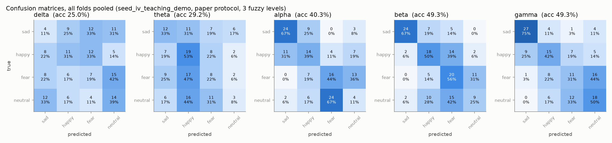
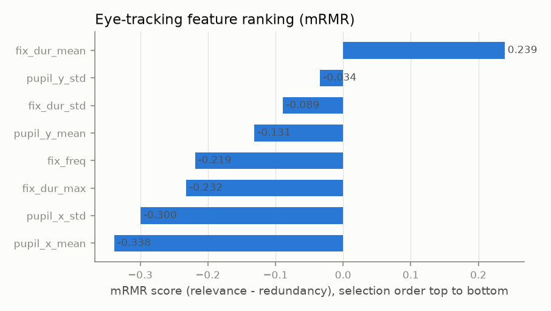
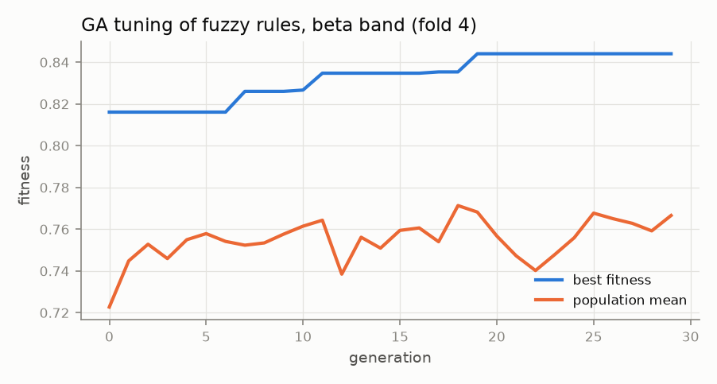
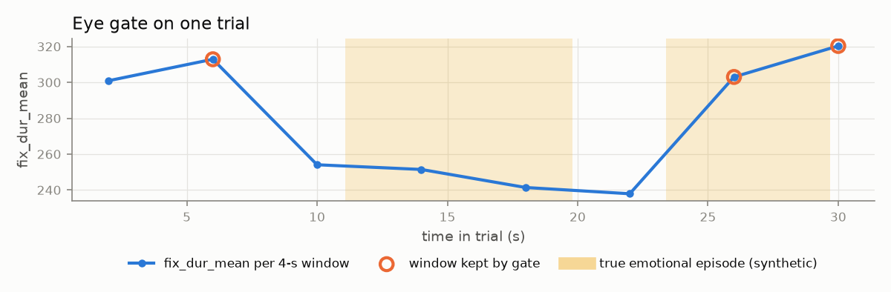
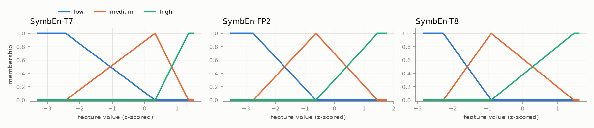
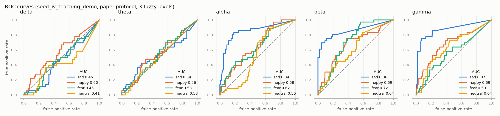

# Results: eye-gated S-FIS-GA emotion recognition

> **Synthetic demo data.** These numbers only show that the pipeline runs and that each stage does what it should. They are not emotion-recognition results and must not be compared with the paper.

- Dataset: `data/seed_iv` (seed_iv_teaching_demo), classes: sad, happy, fear, neutral
- Windows: 384 total, 144 kept by the eye gate (`fix_dur_mean`, mode `quantile`)
- Protocol: `paper`, 5 folds; features: mRMR on each training fold
- Runtime: 262 s

## Eye-feature ranking (mRMR)

| rank | feature | score |
|---|---|---|
| 1 | fix_dur_mean | 0.2387 |
| 2 | pupil_y_std | -0.0340 |
| 3 | fix_dur_std | -0.0889 |
| 4 | pupil_y_mean | -0.1312 |
| 5 | fix_freq | -0.2190 |
| 6 | fix_dur_max | -0.2318 |
| 7 | pupil_x_std | -0.2998 |
| 8 | pupil_x_mean | -0.3381 |

Gate check against the known synthetic episodes: 60.9% of all windows are inside an episode vs 64.6% of the windows the gate keeps (episode recall 39.7%).

## Accuracy by band and number of fuzzy levels (mean ± std over folds, %)

| band | 3 levels |
|---|---|
| delta | 24.98 ± 6.60 |
| theta | 29.19 ± 7.50 |
| alpha | 40.34 ± 8.13 |
| beta | 49.33 ± 4.85 |
| gamma | 49.31 ± 5.52 |

Best number of levels: **3** (the paper also found 3 best).

## Full metrics, 3 levels

| band | accuracy | macro F1 | macro precision | macro recall (TPR) | macro AUC | lookup table only (no GA) |
|---|---|---|---|---|---|---|
| delta | 24.98 ± 6.60 | 23.67 ± 7.45 | 24.89 ± 7.95 | 25.09 ± 6.58 | 0.479 | 24.29 ± 6.09 |
| theta | 29.19 ± 7.50 | 27.18 ± 7.93 | 31.61 ± 14.90 | 29.37 ± 7.78 | 0.540 | 27.17 ± 7.78 |
| alpha | 40.34 ± 8.13 | 38.56 ± 6.79 | 42.21 ± 11.69 | 40.54 ± 8.63 | 0.678 | 44.51 ± 11.48 |
| beta | 49.33 ± 4.85 | 49.21 ± 4.26 | 53.40 ± 3.58 | 49.37 ± 4.36 | 0.727 | 50.05 ± 8.63 |
| gamma | 49.31 ± 5.52 | 47.47 ± 4.93 | 51.60 ± 7.54 | 49.38 ± 5.19 | 0.696 | 49.31 ± 7.03 |

Per-class (mean over folds):

| band | metric | sad | happy | fear | neutral |
|---|---|---|---|---|---|
| delta | TPR | 0.111 | 0.307 | 0.196 | 0.389 |
| delta | FNR | 0.889 | 0.693 | 0.804 | 0.611 |
| delta | F1 | 0.117 | 0.302 | 0.184 | 0.343 |
| delta | AUC | 0.448 | 0.604 | 0.449 | 0.415 |
| theta | TPR | 0.336 | 0.532 | 0.225 | 0.082 |
| theta | FNR | 0.664 | 0.468 | 0.775 | 0.918 |
| theta | F1 | 0.359 | 0.376 | 0.235 | 0.117 |
| theta | AUC | 0.535 | 0.557 | 0.533 | 0.532 |
| alpha | TPR | 0.668 | 0.393 | 0.450 | 0.111 |
| alpha | FNR | 0.332 | 0.607 | 0.550 | 0.889 |
| alpha | F1 | 0.662 | 0.363 | 0.396 | 0.122 |
| alpha | AUC | 0.844 | 0.683 | 0.623 | 0.563 |
| beta | TPR | 0.664 | 0.504 | 0.554 | 0.254 |
| beta | FNR | 0.336 | 0.496 | 0.446 | 0.746 |
| beta | F1 | 0.747 | 0.469 | 0.449 | 0.303 |
| beta | AUC | 0.858 | 0.688 | 0.724 | 0.637 |
| gamma | TPR | 0.750 | 0.425 | 0.307 | 0.493 |
| gamma | FNR | 0.250 | 0.575 | 0.693 | 0.507 |
| gamma | F1 | 0.747 | 0.436 | 0.324 | 0.393 |
| gamma | AUC | 0.866 | 0.690 | 0.593 | 0.637 |

## Mined fuzzy rules (3 levels, best fold of each band, ranked by coverage × accuracy × weight)

### delta

| # | rule | coverage | accuracy |
|---|---|---|---|
| 1 | If SymbEn-T8 is high and PermEn-FCZ is low and SymbEn-P3 is high then class is happy | 11% | 72.9% |
| 2 | If SymbEn-T8 is high and PermEn-FCZ is medium then class is neutral | 63% | 36.2% |
| 3 | If SymbEn-T8 is medium and PermEn-FCZ is medium and SymbEn-P3 is high then class is fear | 47% | 38.6% |
| 4 | If SymbEn-T8 is medium and PermEn-FCZ is medium and SymbEn-P3 is low then class is sad | 43% | 38.0% |
| 5 | If SymbEn-T8 is low and PermEn-FCZ is low and SymbEn-P3 is high then class is happy | 7% | 62.8% |
| 6 | If SymbEn-T8 is low and SymbEn-P3 is medium then class is fear | 30% | 38.6% |
| 7 | If SymbEn-T8 is low and SymbEn-P3 is low then class is happy | 15% | 45.7% |
| 8 | If SymbEn-T8 is high and SymbEn-P3 is low then class is neutral | 31% | 36.9% |
| 9 | If SymbEn-T8 is low and PermEn-FCZ is high then class is neutral | 21% | 39.2% |
| 10 | If SymbEn-T8 is high and SymbEn-P3 is high then class is neutral | 37% | 33.9% |

### theta

| # | rule | coverage | accuracy |
|---|---|---|---|
| 1 | If PhEn-P1 is medium and SampEn-C4 is high and SymbEn-FC2 is high then class is happy | 60% | 45.2% |
| 2 | If PhEn-P1 is medium and SampEn-C4 is high and SymbEn-FC2 is medium then class is fear | 59% | 42.0% |
| 3 | If SampEn-C4 is high and SymbEn-FC2 is medium then class is fear | 62% | 38.5% |
| 4 | If PhEn-P1 is low and SymbEn-FC2 is high then class is neutral | 23% | 47.8% |
| 5 | If PhEn-P1 is medium and SampEn-C4 is low and SymbEn-FC2 is high then class is sad | 29% | 41.5% |
| 6 | If PhEn-P1 is medium and SymbEn-FC2 is medium then class is happy | 90% | 31.6% |
| 7 | If PhEn-P1 is low and SampEn-C4 is high then class is fear | 16% | 46.1% |
| 8 | If PhEn-P1 is medium and SampEn-C4 is low and SymbEn-FC2 is medium then class is sad | 30% | 37.8% |
| 9 | If PhEn-P1 is low and SampEn-C4 is high and SymbEn-FC2 is high then class is fear | 14% | 47.0% |
| 10 | If PhEn-P1 is low and SampEn-C4 is high and SymbEn-FC2 is low then class is neutral | 2% | 93.2% |

### alpha

| # | rule | coverage | accuracy |
|---|---|---|---|
| 1 | If SymbEn-FP2 is low and SymbEn-T8 is medium and PermEn-TP7 is low then class is sad | 34% | 71.3% |
| 2 | If SymbEn-T8 is low and PermEn-TP7 is medium then class is sad | 29% | 66.7% |
| 3 | If SymbEn-FP2 is medium and SymbEn-T8 is high and PermEn-TP7 is high then class is fear | 35% | 56.8% |
| 4 | If SymbEn-FP2 is low and SymbEn-T8 is high and PermEn-TP7 is medium then class is happy | 32% | 50.4% |
| 5 | If SymbEn-FP2 is medium and PermEn-TP7 is low then class is sad | 51% | 43.3% |
| 6 | If SymbEn-FP2 is high and PermEn-TP7 is medium then class is fear | 40% | 46.1% |
| 7 | If SymbEn-FP2 is medium and SymbEn-T8 is medium and PermEn-TP7 is medium then class is happy | 84% | 37.2% |
| 8 | If SymbEn-FP2 is high and SymbEn-T8 is high and PermEn-TP7 is high then class is neutral | 22% | 50.9% |
| 9 | If SymbEn-FP2 is medium and SymbEn-T8 is high and PermEn-TP7 is medium then class is fear | 62% | 36.8% |
| 10 | If SymbEn-FP2 is medium and SymbEn-T8 is low and PermEn-TP7 is high then class is happy | 9% | 67.3% |

### beta

| # | rule | coverage | accuracy |
|---|---|---|---|
| 1 | If SymbEn-T7 is low and SymbEn-FP2 is medium and SymbEn-T8 is medium then class is sad | 46% | 67.7% |
| 2 | If SymbEn-FP2 is low and SymbEn-T8 is medium then class is sad | 19% | 90.3% |
| 3 | If SymbEn-T7 is low and SymbEn-FP2 is medium and SymbEn-T8 is low then class is sad | 14% | 95.6% |
| 4 | If SymbEn-T7 is low and SymbEn-FP2 is medium and SymbEn-T8 is high then class is happy | 35% | 63.7% |
| 5 | If SymbEn-T7 is low and SymbEn-FP2 is high and SymbEn-T8 is low then class is sad | 7% | 100.0% |
| 6 | If SymbEn-T7 is medium and SymbEn-FP2 is high and SymbEn-T8 is high then class is fear | 67% | 42.8% |
| 7 | If SymbEn-T7 is high and SymbEn-FP2 is medium and SymbEn-T8 is high then class is fear | 43% | 44.1% |
| 8 | If SymbEn-FP2 is medium and SymbEn-T8 is medium then class is happy | 90% | 36.0% |
| 9 | If SymbEn-T7 is medium and SymbEn-FP2 is medium and SymbEn-T8 is high then class is happy | 75% | 36.4% |
| 10 | If SymbEn-T7 is high and SymbEn-FP2 is medium then class is neutral | 46% | 40.9% |

### gamma

| # | rule | coverage | accuracy |
|---|---|---|---|
| 1 | If SymbEn-T8 is low and SampEn-CB1 is low and SymbEn-FP2 is medium then class is sad | 36% | 85.1% |
| 2 | If SymbEn-T8 is low and SymbEn-FP2 is low then class is sad | 22% | 97.3% |
| 3 | If SymbEn-T8 is low and SampEn-CB1 is medium and SymbEn-FP2 is medium then class is sad | 30% | 71.4% |
| 4 | If SymbEn-T8 is high and SampEn-CB1 is low and SymbEn-FP2 is high then class is fear | 56% | 54.2% |
| 5 | If SymbEn-T8 is medium and SampEn-CB1 is medium and SymbEn-FP2 is medium then class is happy | 70% | 43.6% |
| 6 | If SymbEn-T8 is medium and SampEn-CB1 is low and SymbEn-FP2 is high then class is neutral | 70% | 43.1% |
| 7 | If SymbEn-T8 is medium and SampEn-CB1 is medium and SymbEn-FP2 is high then class is neutral | 50% | 38.8% |
| 8 | If SymbEn-T8 is medium and SampEn-CB1 is low then class is neutral | 95% | 32.5% |
| 9 | If SymbEn-T8 is high and SampEn-CB1 is medium and SymbEn-FP2 is medium then class is neutral | 43% | 37.8% |

### Best rule per class (all bands)

| class | band | rule | coverage | accuracy |
|---|---|---|---|---|
| sad | gamma | If SymbEn-T8 is low and SampEn-CB1 is low and SymbEn-FP2 is medium then class is sad | 36% | 85.1% |
| happy | beta | If SymbEn-T7 is low and SymbEn-FP2 is medium and SymbEn-T8 is high then class is happy | 35% | 63.7% |
| fear | gamma | If SymbEn-T8 is high and SampEn-CB1 is low and SymbEn-FP2 is high then class is fear | 56% | 54.2% |
| neutral | gamma | If SymbEn-T8 is medium and SampEn-CB1 is low and SymbEn-FP2 is high then class is neutral | 70% | 43.1% |

## Figures

