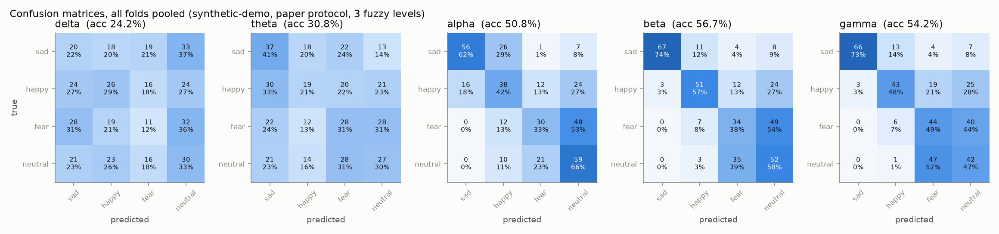
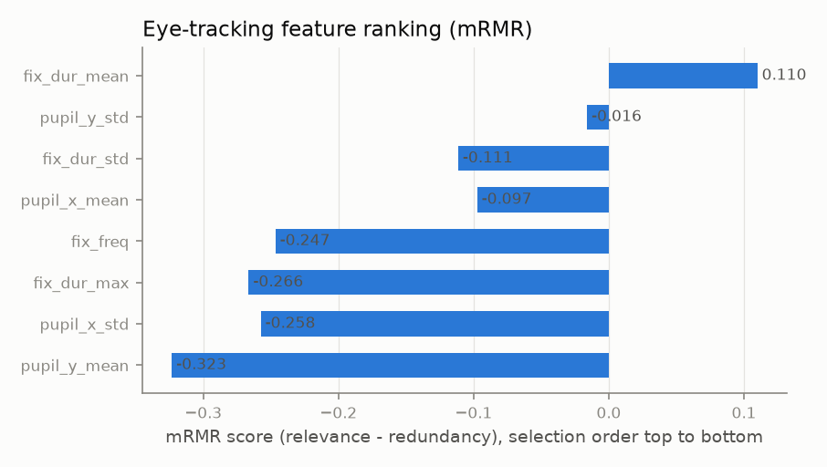
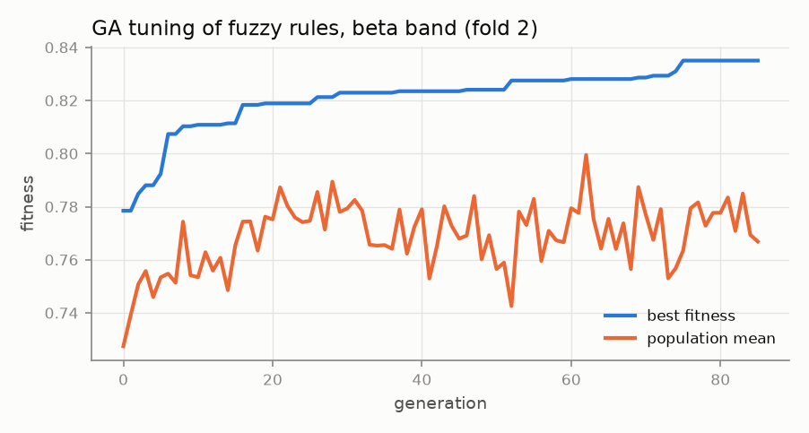
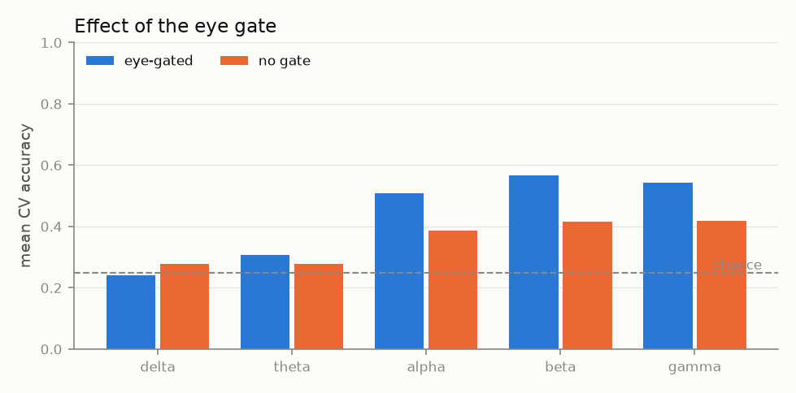
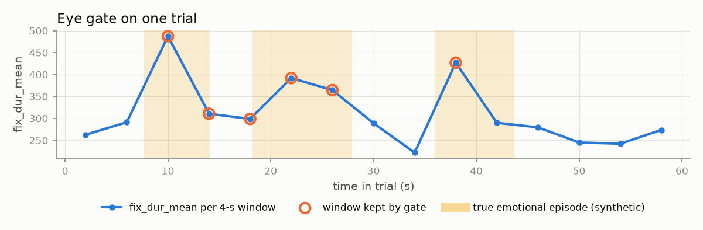
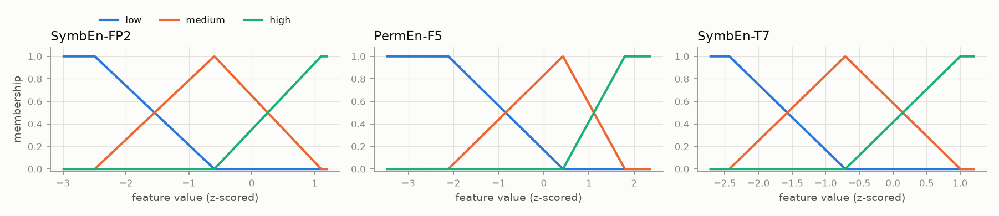
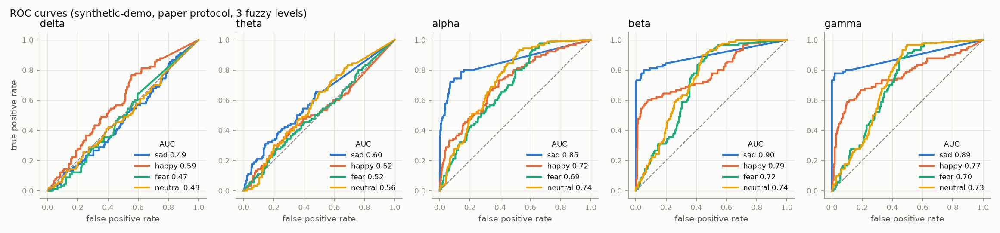

# Results: eye-gated S-FIS-GA emotion recognition

> **Synthetic demo data.** These numbers only show that the pipeline runs and that each stage does what it should. They are not emotion-recognition results and must not be compared with the paper.

- Dataset: `data/demo_easy` (synthetic-demo), classes: sad, happy, fear, neutral
- Windows: 900 total, 360 kept by the eye gate (`fix_dur_mean`, mode `quantile`)
- Protocol: `paper`, 5 folds; features: mRMR on each training fold
- Runtime: 1157 s

## Eye-feature ranking (mRMR)

| rank | feature | score |
|---|---|---|
| 1 | fix_dur_mean | 0.1099 |
| 2 | pupil_y_std | -0.0161 |
| 3 | fix_dur_std | -0.1114 |
| 4 | pupil_x_mean | -0.0974 |
| 5 | fix_freq | -0.2467 |
| 6 | fix_dur_max | -0.2664 |
| 7 | pupil_x_std | -0.2575 |
| 8 | pupil_y_mean | -0.3233 |

Gate check against the known synthetic episodes: 40.3% of all windows are inside an episode vs 50.0% of the windows the gate keeps (episode recall 49.6%).

## Accuracy by band and number of fuzzy levels (mean ± std over folds, %)

| band | 3 levels |
|---|---|
| delta | 24.17 ± 5.09 |
| theta | 30.83 ± 5.92 |
| alpha | 50.83 ± 2.58 |
| beta | 56.67 ± 3.22 |
| gamma | 54.17 ± 4.73 |

Best number of levels: **3** (the paper also found 3 best).

## Full metrics, 3 levels

| band | accuracy | macro F1 | macro precision | macro recall (TPR) | macro AUC | lookup table only (no GA) |
|---|---|---|---|---|---|---|
| delta | 24.17 ± 5.09 | 22.98 ± 4.92 | 25.95 ± 5.61 | 24.17 ± 5.09 | 0.507 | 22.50 ± 3.33 |
| theta | 30.83 ± 5.92 | 28.49 ± 6.89 | 29.77 ± 8.52 | 30.83 ± 5.92 | 0.550 | 30.00 ± 2.42 |
| alpha | 50.83 ± 2.58 | 49.88 ± 2.99 | 53.59 ± 2.54 | 50.83 ± 2.58 | 0.751 | 47.78 ± 3.36 |
| beta | 56.67 ± 3.22 | 55.52 ± 4.10 | 60.81 ± 4.38 | 56.67 ± 3.22 | 0.790 | 56.67 ± 3.22 |
| gamma | 54.17 ± 4.73 | 55.00 ± 4.22 | 60.92 ± 3.57 | 54.17 ± 4.73 | 0.773 | 53.89 ± 6.36 |

Per-class (mean over folds):

| band | metric | sad | happy | fear | neutral |
|---|---|---|---|---|---|
| delta | TPR | 0.222 | 0.289 | 0.122 | 0.333 |
| delta | FNR | 0.778 | 0.711 | 0.878 | 0.667 |
| delta | F1 | 0.220 | 0.292 | 0.139 | 0.267 |
| delta | AUC | 0.487 | 0.587 | 0.468 | 0.487 |
| theta | TPR | 0.411 | 0.211 | 0.311 | 0.300 |
| theta | FNR | 0.589 | 0.789 | 0.689 | 0.700 |
| theta | F1 | 0.366 | 0.218 | 0.284 | 0.271 |
| theta | AUC | 0.602 | 0.520 | 0.522 | 0.558 |
| alpha | TPR | 0.622 | 0.422 | 0.333 | 0.656 |
| alpha | FNR | 0.378 | 0.578 | 0.667 | 0.344 |
| alpha | F1 | 0.687 | 0.423 | 0.368 | 0.518 |
| alpha | AUC | 0.852 | 0.719 | 0.691 | 0.743 |
| beta | TPR | 0.744 | 0.567 | 0.378 | 0.578 |
| beta | FNR | 0.256 | 0.433 | 0.622 | 0.422 |
| beta | F1 | 0.834 | 0.631 | 0.325 | 0.431 |
| beta | AUC | 0.899 | 0.794 | 0.722 | 0.744 |
| gamma | TPR | 0.733 | 0.478 | 0.489 | 0.467 |
| gamma | FNR | 0.267 | 0.522 | 0.511 | 0.533 |
| gamma | F1 | 0.822 | 0.557 | 0.416 | 0.404 |
| gamma | AUC | 0.886 | 0.774 | 0.699 | 0.732 |

## Ablations

| band | eye-gated acc | no-gate acc |
|---|---|---|
| delta | 24.17 ± 5.09 | 27.67 ± 2.86 |
| theta | 30.83 ± 5.92 | 27.67 ± 1.24 |
| alpha | 50.83 ± 2.58 | 38.78 ± 2.52 |
| beta | 56.67 ± 3.22 | 41.44 ± 2.99 |
| gamma | 54.17 ± 4.73 | 41.89 ± 3.76 |

Shuffled-label control (beta band): accuracy 28.06 ± 5.72 (should be near chance, 25%).

## Mined fuzzy rules (3 levels, best fold of each band, ranked by coverage × accuracy × weight)

### delta

| # | rule | coverage | accuracy |
|---|---|---|---|
| 1 | If SampEn-FT8 is high and SymbEn-C1 is low and PermEn-FP2 is medium then class is sad | 42% | 41.3% |
| 2 | If SymbEn-C1 is high and PermEn-FP2 is high then class is neutral | 36% | 43.1% |
| 3 | If SampEn-FT8 is high and SymbEn-C1 is low and PermEn-FP2 is high then class is fear | 33% | 40.0% |
| 4 | If SampEn-FT8 is high and SymbEn-C1 is high and PermEn-FP2 is high then class is neutral | 32% | 38.4% |
| 5 | If SampEn-FT8 is medium and PermEn-FP2 is high then class is fear | 73% | 31.8% |
| 6 | If SampEn-FT8 is high and SymbEn-C1 is high and PermEn-FP2 is medium then class is happy | 40% | 35.3% |
| 7 | If SampEn-FT8 is medium and SymbEn-C1 is low and PermEn-FP2 is low then class is happy | 12% | 46.9% |
| 8 | If SampEn-FT8 is low and SymbEn-C1 is medium and PermEn-FP2 is low then class is sad | 4% | 67.2% |
| 9 | If SampEn-FT8 is low and SymbEn-C1 is low and PermEn-FP2 is high then class is sad | 7% | 54.5% |
| 10 | If SampEn-FT8 is low and SymbEn-C1 is medium and PermEn-FP2 is high then class is neutral | 10% | 46.4% |

### theta

| # | rule | coverage | accuracy |
|---|---|---|---|
| 1 | If PermEn-TP7 is medium and SymbEn-T7 is low then class is sad | 27% | 59.0% |
| 2 | If SymbEn-T8 is high and PermEn-TP7 is high and SymbEn-T7 is high then class is fear | 27% | 58.5% |
| 3 | If SymbEn-T8 is low and SymbEn-T7 is medium then class is sad | 48% | 43.6% |
| 4 | If SymbEn-T8 is high then class is neutral | 49% | 38.7% |
| 5 | If SymbEn-T8 is high and PermEn-TP7 is medium and SymbEn-T7 is medium then class is neutral | 45% | 37.6% |
| 6 | If SymbEn-T8 is medium and PermEn-TP7 is low and SymbEn-T7 is high then class is neutral | 18% | 47.8% |
| 7 | If SymbEn-T8 is medium and PermEn-TP7 is medium and SymbEn-T7 is high then class is fear | 66% | 33.2% |
| 8 | If PermEn-TP7 is high and SymbEn-T7 is medium then class is happy | 71% | 31.1% |
| 9 | If SymbEn-T8 is low and SymbEn-T7 is high then class is fear | 35% | 34.2% |
| 10 | If SymbEn-T8 is medium and PermEn-TP7 is low and SymbEn-T7 is medium then class is neutral | 24% | 36.4% |

### alpha

| # | rule | coverage | accuracy |
|---|---|---|---|
| 1 | If SymbEn-T8 is low and SymbEn-C4 is medium and PermEn-T7 is medium then class is sad | 20% | 83.1% |
| 2 | If SymbEn-T8 is medium and SymbEn-C4 is medium and PermEn-T7 is medium then class is happy | 88% | 45.4% |
| 3 | If SymbEn-T8 is medium and PermEn-T7 is low then class is sad | 18% | 79.0% |
| 4 | If SymbEn-T8 is medium and SymbEn-C4 is medium and PermEn-T7 is low then class is sad | 17% | 76.1% |
| 5 | If SymbEn-T8 is low and SymbEn-C4 is low and PermEn-T7 is medium then class is sad | 11% | 85.3% |
| 6 | If SymbEn-T8 is low and SymbEn-C4 is low and PermEn-T7 is low then class is sad | 8% | 98.8% |
| 7 | If SymbEn-T8 is low and SymbEn-C4 is high and PermEn-T7 is low then class is sad | 7% | 97.6% |
| 8 | If SymbEn-T8 is high and SymbEn-C4 is medium and PermEn-T7 is medium then class is neutral | 72% | 40.6% |
| 9 | If SymbEn-T8 is medium and SymbEn-C4 is low and PermEn-T7 is medium then class is happy | 52% | 43.3% |
| 10 | If SymbEn-T8 is medium and SymbEn-C4 is high and PermEn-T7 is medium then class is happy | 40% | 43.8% |

### beta

| # | rule | coverage | accuracy |
|---|---|---|---|
| 1 | If SymbEn-FP2 is medium and SymbEn-T7 is medium then class is happy | 92% | 58.2% |
| 2 | If SymbEn-FP2 is low then class is sad | 26% | 93.4% |
| 3 | If SymbEn-FP2 is high and PermEn-F5 is medium then class is fear | 70% | 39.0% |
| 4 | If SymbEn-FP2 is high and SymbEn-T7 is high then class is neutral | 72% | 38.6% |
| 5 | If SymbEn-FP2 is medium and PermEn-F5 is low and SymbEn-T7 is high then class is fear | 49% | 38.3% |
| 6 | If PermEn-F5 is high and SymbEn-T7 is medium then class is sad | 34% | 41.9% |
| 7 | If SymbEn-FP2 is low and SymbEn-T7 is high then class is sad | 6% | 63.3% |

### gamma

| # | rule | coverage | accuracy |
|---|---|---|---|
| 1 | If SymbEn-FP2 is low and SampEn-FC3 is high then class is sad | 22% | 96.4% |
| 2 | If SymbEn-FP2 is medium and SymbEn-T7 is low then class is sad | 20% | 95.0% |
| 3 | If SymbEn-FP2 is low and SymbEn-T7 is medium then class is sad | 23% | 90.4% |
| 4 | If SampEn-FC3 is medium and SymbEn-T7 is high then class is neutral | 76% | 46.2% |
| 5 | If SampEn-FC3 is high and SymbEn-T7 is medium then class is happy | 89% | 40.7% |
| 6 | If SymbEn-FP2 is high and SampEn-FC3 is high and SymbEn-T7 is high then class is neutral | 69% | 39.0% |
| 7 | If SymbEn-FP2 is high and SampEn-FC3 is high then class is fear | 70% | 38.3% |
| 8 | If SymbEn-FP2 is medium and SampEn-FC3 is high and SymbEn-T7 is high then class is fear | 70% | 33.4% |
| 9 | If SymbEn-FP2 is medium and SampEn-FC3 is low and SymbEn-T7 is medium then class is happy | 7% | 57.6% |

### Best rule per class (all bands)

| class | band | rule | coverage | accuracy |
|---|---|---|---|---|
| sad | beta | If SymbEn-FP2 is low then class is sad | 26% | 93.4% |
| happy | beta | If SymbEn-FP2 is medium and SymbEn-T7 is medium then class is happy | 92% | 58.2% |
| fear | theta | If SymbEn-T8 is high and PermEn-TP7 is high and SymbEn-T7 is high then class is fear | 27% | 58.5% |
| neutral | gamma | If SampEn-FC3 is medium and SymbEn-T7 is high then class is neutral | 76% | 46.2% |

## Figures

