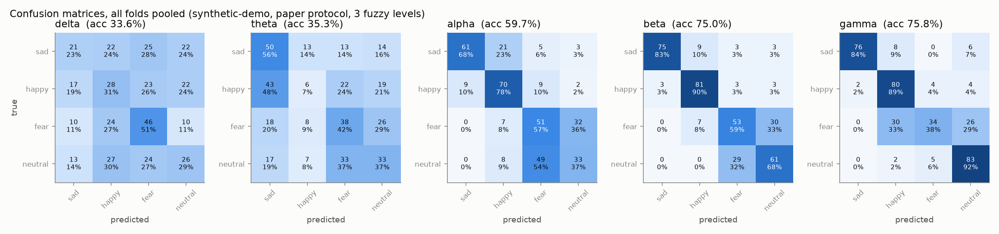
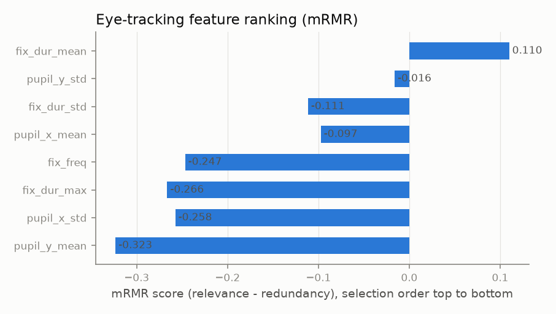
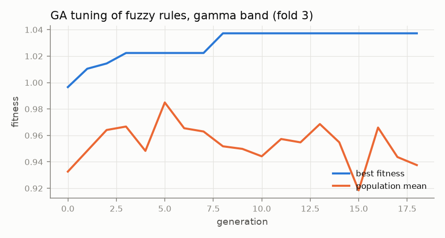
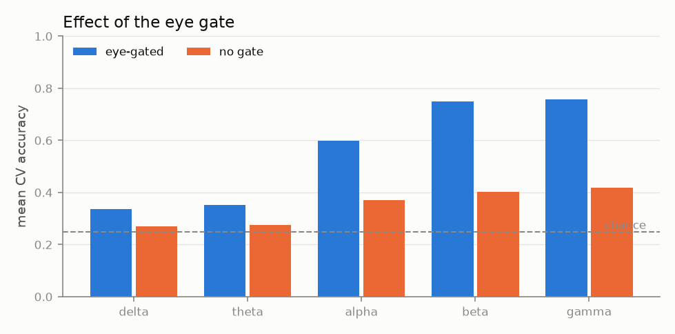
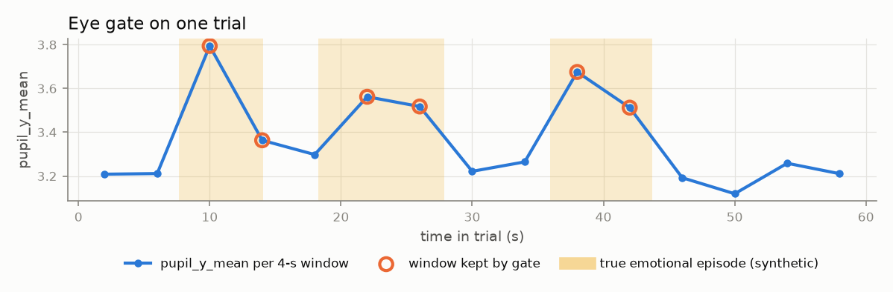
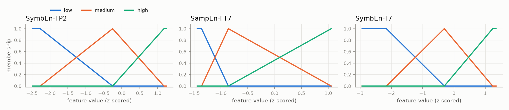
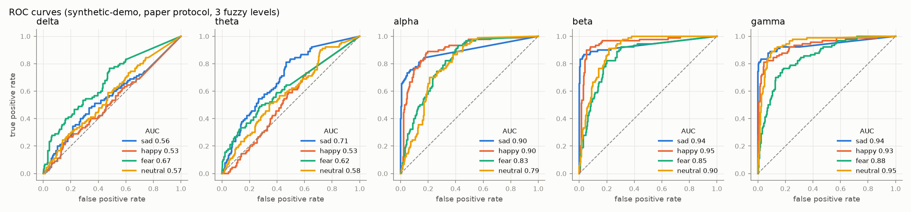

# Results: eye-gated S-FIS-GA emotion recognition

> **Synthetic demo data.** These numbers only show that the pipeline runs and that each stage does what it should. They are not emotion-recognition results and must not be compared with the paper.

- Dataset: `data/demo_easy` (synthetic-demo), classes: sad, happy, fear, neutral
- Windows: 900 total, 360 kept by the eye gate (`pupil_y_mean`, mode `quantile`)
- Protocol: `paper`, 5 folds; features: mRMR on each training fold
- Runtime: 208 s

## Eye-feature ranking (mRMR)

| rank | feature | score |
|---|---|---|
| 1 | fix_dur_mean | 0.1099 |
| 2 | pupil_y_std | -0.0161 |
| 3 | fix_dur_std | -0.1114 |
| 4 | pupil_x_mean | -0.0974 |
| 5 | fix_freq | -0.2467 |
| 6 | fix_dur_max | -0.2664 |
| 7 | pupil_x_std | -0.2575 |
| 8 | pupil_y_mean | -0.3233 |

Gate check against the known synthetic episodes: 40.3% of all windows are inside an episode vs 92.8% of the windows the gate keeps (episode recall 92.0%).

## Accuracy by band and number of fuzzy levels (mean ± std over folds, %)

| band | 3 levels |
|---|---|
| delta | 33.61 ± 4.43 |
| theta | 35.28 ± 5.87 |
| alpha | 59.72 ± 3.17 |
| beta | 75.00 ± 6.80 |
| gamma | 75.83 ± 2.42 |

Best number of levels: **3** (the paper also found 3 best).

## Full metrics, 3 levels

| band | accuracy | macro F1 | macro precision | macro recall (TPR) | macro AUC | lookup table only (no GA) |
|---|---|---|---|---|---|---|
| delta | 33.61 ± 4.43 | 30.80 ± 4.72 | 32.97 ± 6.06 | 33.61 ± 4.43 | 0.584 | 31.11 ± 5.46 |
| theta | 35.28 ± 5.87 | 31.40 ± 6.78 | 30.98 ± 8.12 | 35.28 ± 5.87 | 0.610 | 34.72 ± 3.40 |
| alpha | 59.72 ± 3.17 | 58.05 ± 4.49 | 61.33 ± 5.53 | 59.72 ± 3.17 | 0.855 | 61.39 ± 2.83 |
| beta | 75.00 ± 6.80 | 74.77 ± 7.46 | 76.25 ± 7.98 | 75.00 ± 6.80 | 0.908 | 76.39 ± 6.02 |
| gamma | 75.83 ± 2.42 | 74.23 ± 2.54 | 78.81 ± 3.96 | 75.83 ± 2.42 | 0.926 | 81.94 ± 4.73 |

Per-class (mean over folds):

| band | metric | sad | happy | fear | neutral |
|---|---|---|---|---|---|
| delta | TPR | 0.233 | 0.311 | 0.511 | 0.289 |
| delta | FNR | 0.767 | 0.689 | 0.489 | 0.711 |
| delta | F1 | 0.245 | 0.250 | 0.440 | 0.297 |
| delta | AUC | 0.563 | 0.529 | 0.673 | 0.570 |
| theta | TPR | 0.556 | 0.067 | 0.422 | 0.367 |
| theta | FNR | 0.444 | 0.933 | 0.578 | 0.633 |
| theta | F1 | 0.451 | 0.086 | 0.381 | 0.338 |
| theta | AUC | 0.709 | 0.532 | 0.617 | 0.584 |
| alpha | TPR | 0.678 | 0.778 | 0.567 | 0.367 |
| alpha | FNR | 0.322 | 0.222 | 0.433 | 0.633 |
| alpha | F1 | 0.761 | 0.717 | 0.475 | 0.369 |
| alpha | AUC | 0.896 | 0.904 | 0.827 | 0.790 |
| beta | TPR | 0.833 | 0.900 | 0.589 | 0.678 |
| beta | FNR | 0.167 | 0.100 | 0.411 | 0.322 |
| beta | F1 | 0.892 | 0.869 | 0.577 | 0.653 |
| beta | AUC | 0.937 | 0.948 | 0.848 | 0.899 |
| gamma | TPR | 0.844 | 0.889 | 0.378 | 0.922 |
| gamma | FNR | 0.156 | 0.111 | 0.622 | 0.078 |
| gamma | F1 | 0.904 | 0.762 | 0.508 | 0.795 |
| gamma | AUC | 0.941 | 0.932 | 0.877 | 0.952 |

## Ablations

| band | eye-gated acc | no-gate acc |
|---|---|---|
| delta | 33.61 ± 4.43 | 26.89 ± 1.81 |
| theta | 35.28 ± 5.87 | 27.44 ± 0.75 |
| alpha | 59.72 ± 3.17 | 37.11 ± 4.24 |
| beta | 75.00 ± 6.80 | 40.22 ± 3.31 |
| gamma | 75.83 ± 2.42 | 41.78 ± 5.00 |

Shuffled-label control (gamma band): accuracy 30.83 ± 3.22 (should be near chance, 25%).

## Mined fuzzy rules (3 levels, best fold of each band, ranked by coverage × accuracy × weight)

### delta

| # | rule | coverage | accuracy |
|---|---|---|---|
| 1 | If PhEn-FPZ is medium and SampEn-FP2 is low and SymbEn-T7 is high then class is fear | 15% | 71.4% |
| 2 | If SampEn-FP2 is medium and SymbEn-T7 is high then class is fear | 41% | 46.9% |
| 3 | If PhEn-FPZ is low and SampEn-FP2 is medium and SymbEn-T7 is high then class is fear | 14% | 61.3% |
| 4 | If PhEn-FPZ is high then class is happy | 70% | 34.2% |
| 5 | If PhEn-FPZ is medium and SymbEn-T7 is low then class is neutral | 54% | 34.6% |
| 6 | If PhEn-FPZ is medium and SampEn-FP2 is medium and SymbEn-T7 is low then class is neutral | 52% | 33.3% |
| 7 | If PhEn-FPZ is high and SampEn-FP2 is medium and SymbEn-T7 is low then class is neutral | 40% | 34.5% |
| 8 | If SampEn-FP2 is medium and SymbEn-T7 is medium then class is happy | 92% | 29.5% |
| 9 | If PhEn-FPZ is high and SymbEn-T7 is high then class is fear | 28% | 35.5% |
| 10 | If PhEn-FPZ is high and SampEn-FP2 is high then class is sad | 43% | 32.4% |

### theta

| # | rule | coverage | accuracy |
|---|---|---|---|
| 1 | If SymbEn-T8 is high and SymbEn-T7 is high then class is fear | 18% | 65.7% |
| 2 | If SymbEn-T8 is low and SampEn-T7 is low and SymbEn-T7 is low then class is sad | 11% | 76.4% |
| 3 | If SymbEn-T8 is high and SampEn-T7 is high and SymbEn-T7 is medium then class is neutral | 40% | 47.4% |
| 4 | If SymbEn-T8 is medium and SampEn-T7 is medium and SymbEn-T7 is low then class is sad | 71% | 39.8% |
| 5 | If SymbEn-T8 is high and SampEn-T7 is low and SymbEn-T7 is high then class is fear | 6% | 89.3% |
| 6 | If SymbEn-T8 is low and SampEn-T7 is high and SymbEn-T7 is medium then class is sad | 13% | 64.7% |
| 7 | If SymbEn-T8 is high and SampEn-T7 is high and SymbEn-T7 is high then class is neutral | 12% | 58.3% |
| 8 | If SymbEn-T8 is high and SampEn-T7 is low and SymbEn-T7 is medium then class is fear | 31% | 42.2% |
| 9 | If SampEn-T7 is high and SymbEn-T7 is medium then class is neutral | 52% | 36.2% |
| 10 | If SymbEn-T8 is low and SampEn-T7 is medium and SymbEn-T7 is medium then class is happy | 25% | 44.2% |

### alpha

| # | rule | coverage | accuracy |
|---|---|---|---|
| 1 | If PermEn-FP2 is low and SymbEn-FT7 is low and SymbEn-T7 is medium then class is sad | 35% | 79.7% |
| 2 | If PermEn-FP2 is medium and SymbEn-FT7 is medium and SymbEn-T7 is medium then class is happy | 89% | 55.5% |
| 3 | If PermEn-FP2 is low and SymbEn-FT7 is low and SymbEn-T7 is low then class is sad | 20% | 96.2% |
| 4 | If PermEn-FP2 is high and SymbEn-T7 is medium then class is fear | 50% | 51.9% |
| 5 | If PermEn-FP2 is high and SymbEn-FT7 is high and SymbEn-T7 is high then class is fear | 40% | 53.2% |
| 6 | If PermEn-FP2 is medium and SymbEn-FT7 is medium and SymbEn-T7 is high then class is neutral | 70% | 44.2% |
| 7 | If PermEn-FP2 is medium and SymbEn-FT7 is high and SymbEn-T7 is high then class is fear | 47% | 48.1% |
| 8 | If PermEn-FP2 is medium and SymbEn-FT7 is high and SymbEn-T7 is medium then class is neutral | 48% | 43.6% |

### beta

| # | rule | coverage | accuracy |
|---|---|---|---|
| 1 | If SymbEn-FP2 is low and SampEn-FT7 is medium and SymbEn-T7 is low then class is sad | 30% | 97.2% |
| 2 | If SymbEn-FP2 is low and SampEn-FT7 is low and SymbEn-T7 is low then class is sad | 28% | 97.7% |
| 3 | If SymbEn-FP2 is medium and SampEn-FT7 is low and SymbEn-T7 is medium then class is happy | 78% | 59.5% |
| 4 | If SymbEn-FP2 is medium and SampEn-FT7 is low and SymbEn-T7 is low then class is sad | 30% | 83.4% |
| 5 | If SymbEn-FP2 is low and SampEn-FT7 is low and SymbEn-T7 is medium then class is sad | 31% | 79.7% |
| 6 | If SymbEn-FP2 is medium and SampEn-FT7 is medium then class is happy | 93% | 50.9% |
| 7 | If SymbEn-FP2 is high and SampEn-FT7 is medium and SymbEn-T7 is high then class is neutral | 57% | 59.3% |
| 8 | If SymbEn-FP2 is low and SampEn-FT7 is medium and SymbEn-T7 is medium then class is sad | 34% | 72.5% |
| 9 | If SymbEn-FP2 is medium and SampEn-FT7 is medium and SymbEn-T7 is low then class is sad | 32% | 73.2% |
| 10 | If SymbEn-FP2 is medium and SampEn-FT7 is low and SymbEn-T7 is high then class is fear | 50% | 58.0% |

### gamma

| # | rule | coverage | accuracy |
|---|---|---|---|
| 1 | If SymbEn-FP2 is medium and SymbEn-T7 is medium then class is happy | 92% | 63.1% |
| 2 | If SymbEn-FP2 is high and SampEn-FT7 is medium and SymbEn-T7 is medium then class is fear | 66% | 68.2% |
| 3 | If SymbEn-FP2 is low and SampEn-FT7 is medium and SymbEn-T7 is low then class is sad | 25% | 99.9% |
| 4 | If SymbEn-FP2 is medium and SampEn-FT7 is medium and SymbEn-T7 is low then class is sad | 28% | 90.5% |
| 5 | If SymbEn-FP2 is medium and SampEn-FT7 is high and SymbEn-T7 is medium then class is happy | 52% | 69.9% |
| 6 | If SymbEn-FP2 is low and SymbEn-T7 is medium then class is sad | 29% | 85.1% |
| 7 | If SymbEn-FP2 is high and SampEn-FT7 is medium and SymbEn-T7 is high then class is fear | 63% | 57.2% |
| 8 | If SampEn-FT7 is low and SymbEn-T7 is low then class is sad | 16% | 94.9% |
| 9 | If SymbEn-FP2 is high then class is neutral | 69% | 52.5% |
| 10 | If SampEn-FT7 is high and SymbEn-T7 is low then class is sad | 14% | 92.3% |

### Best rule per class (all bands)

| class | band | rule | coverage | accuracy |
|---|---|---|---|---|
| sad | beta | If SymbEn-FP2 is low and SampEn-FT7 is medium and SymbEn-T7 is low then class is sad | 30% | 97.2% |
| happy | gamma | If SymbEn-FP2 is medium and SymbEn-T7 is medium then class is happy | 92% | 63.1% |
| fear | gamma | If SymbEn-FP2 is high and SampEn-FT7 is medium and SymbEn-T7 is medium then class is fear | 66% | 68.2% |
| neutral | beta | If SymbEn-FP2 is high and SampEn-FT7 is medium and SymbEn-T7 is high then class is neutral | 57% | 59.3% |

## Figures

