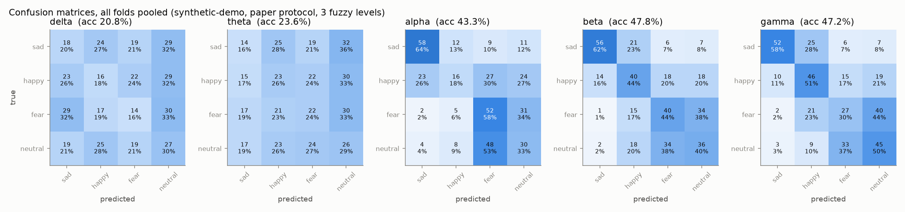
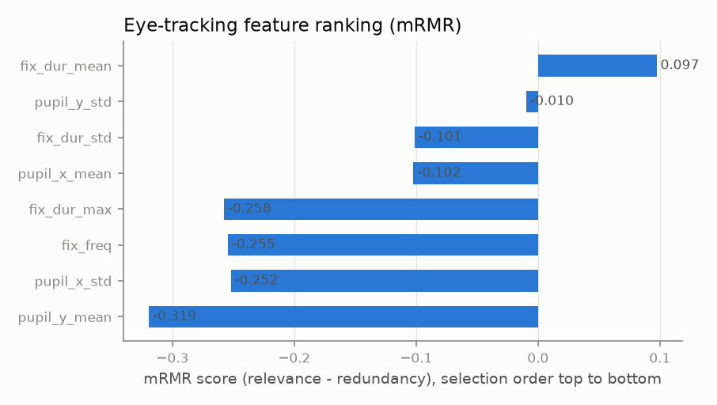
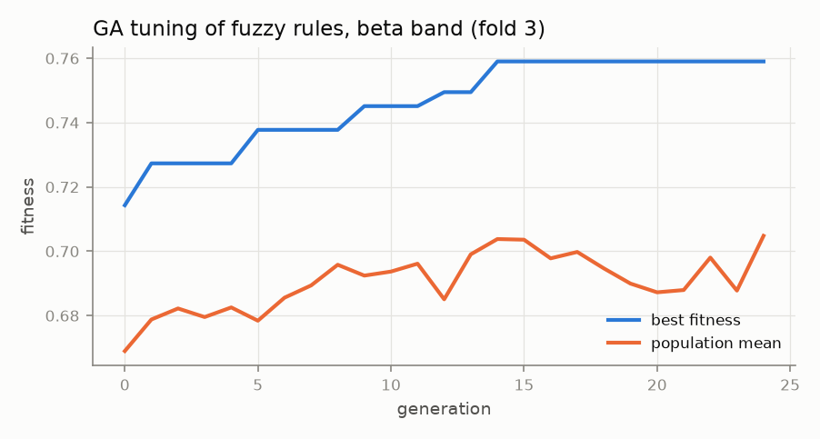
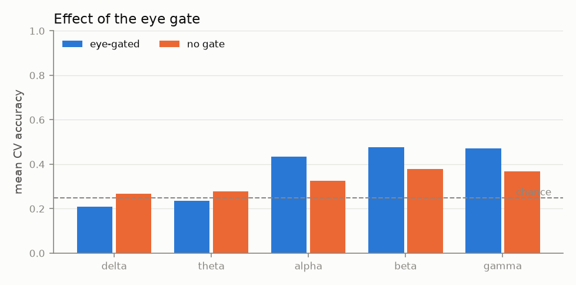
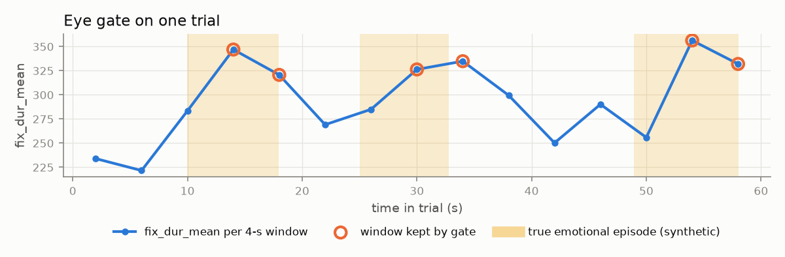
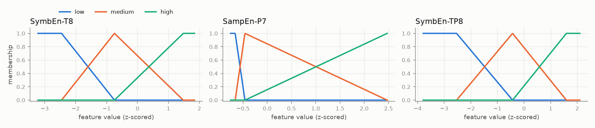
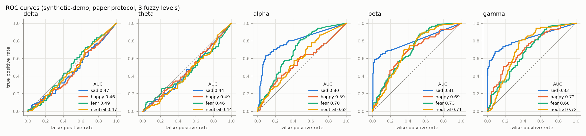

# Results: eye-gated S-FIS-GA emotion recognition

> **Synthetic demo data.** These numbers only show that the pipeline runs and that each stage does what it should. They are not emotion-recognition results and must not be compared with the paper.

- Dataset: `data/demo` (synthetic-demo), classes: sad, happy, fear, neutral
- Windows: 900 total, 360 kept by the eye gate (`fix_dur_mean`, mode `quantile`)
- Protocol: `paper`, 5 folds; features: mRMR on each training fold
- Runtime: 225 s

## Eye-feature ranking (mRMR)

| rank | feature | score |
|---|---|---|
| 1 | fix_dur_mean | 0.0973 |
| 2 | pupil_y_std | -0.0095 |
| 3 | fix_dur_std | -0.1013 |
| 4 | pupil_x_mean | -0.1022 |
| 5 | fix_dur_max | -0.2579 |
| 6 | fix_freq | -0.2545 |
| 7 | pupil_x_std | -0.2522 |
| 8 | pupil_y_mean | -0.3193 |

Gate check against the known synthetic episodes: 39.3% of all windows are inside an episode vs 46.1% of the windows the gate keeps (episode recall 46.9%).

## Accuracy by band and number of fuzzy levels (mean ± std over folds, %)

| band | 2 levels | 3 levels | 4 levels |
|---|---|---|---|
| delta | 25.56 ± 3.36 | 20.83 ± 2.32 | 21.39 ± 5.46 |
| theta | 19.17 ± 2.39 | 23.61 ± 4.21 | 23.33 ± 1.84 |
| alpha | 40.00 ± 2.83 | 43.33 ± 2.69 | 41.94 ± 3.45 |
| beta | 43.89 ± 1.42 | 47.78 ± 4.78 | 49.72 ± 5.85 |
| gamma | 44.44 ± 5.20 | 47.22 ± 3.40 | 45.56 ± 4.84 |

Best number of levels: **3** (the paper also found 3 best).

## Full metrics, 3 levels

| band | accuracy | macro F1 | macro precision | macro recall (TPR) | macro AUC | lookup table only (no GA) |
|---|---|---|---|---|---|---|
| delta | 20.83 ± 2.32 | 19.56 ± 3.36 | 21.24 ± 4.99 | 20.83 ± 2.32 | 0.471 | 23.33 ± 4.25 |
| theta | 23.61 ± 4.21 | 21.53 ± 5.05 | 23.08 ± 7.20 | 23.61 ± 4.21 | 0.457 | 25.83 ± 2.08 |
| alpha | 43.33 ± 2.69 | 39.85 ± 4.78 | 41.78 ± 6.95 | 43.33 ± 2.69 | 0.678 | 43.33 ± 3.77 |
| beta | 47.78 ± 4.78 | 46.72 ± 5.38 | 50.93 ± 4.02 | 47.78 ± 4.78 | 0.734 | 45.56 ± 4.06 |
| gamma | 47.22 ± 3.40 | 46.74 ± 3.89 | 50.61 ± 2.90 | 47.22 ± 3.40 | 0.738 | 48.33 ± 3.09 |

Per-class (mean over folds):

| band | metric | sad | happy | fear | neutral |
|---|---|---|---|---|---|
| delta | TPR | 0.200 | 0.178 | 0.156 | 0.300 |
| delta | FNR | 0.800 | 0.822 | 0.844 | 0.700 |
| delta | F1 | 0.193 | 0.185 | 0.152 | 0.252 |
| delta | AUC | 0.469 | 0.456 | 0.492 | 0.467 |
| theta | TPR | 0.156 | 0.256 | 0.244 | 0.289 |
| theta | FNR | 0.844 | 0.744 | 0.756 | 0.711 |
| theta | F1 | 0.150 | 0.237 | 0.241 | 0.233 |
| theta | AUC | 0.435 | 0.492 | 0.458 | 0.441 |
| alpha | TPR | 0.644 | 0.178 | 0.578 | 0.333 |
| alpha | FNR | 0.356 | 0.822 | 0.422 | 0.667 |
| alpha | F1 | 0.660 | 0.220 | 0.432 | 0.281 |
| alpha | AUC | 0.804 | 0.587 | 0.701 | 0.622 |
| beta | TPR | 0.622 | 0.444 | 0.444 | 0.400 |
| beta | FNR | 0.378 | 0.556 | 0.556 | 0.600 |
| beta | F1 | 0.679 | 0.418 | 0.397 | 0.375 |
| beta | AUC | 0.806 | 0.694 | 0.729 | 0.709 |
| gamma | TPR | 0.578 | 0.511 | 0.300 | 0.500 |
| gamma | FNR | 0.422 | 0.489 | 0.700 | 0.500 |
| gamma | F1 | 0.648 | 0.475 | 0.306 | 0.440 |
| gamma | AUC | 0.826 | 0.719 | 0.683 | 0.724 |

## Ablations

| band | eye-gated acc | no-gate acc |
|---|---|---|
| delta | 20.83 ± 2.32 | 26.78 ± 2.06 |
| theta | 23.61 ± 4.21 | 27.67 ± 4.59 |
| alpha | 43.33 ± 2.69 | 32.56 ± 3.66 |
| beta | 47.78 ± 4.78 | 37.89 ± 1.59 |
| gamma | 47.22 ± 3.40 | 36.67 ± 4.83 |

Shuffled-label control (beta band): accuracy 27.22 ± 5.80 (should be near chance, 25%).

## Mined fuzzy rules (3 levels, best fold of each band, ranked by coverage × accuracy × weight)

### delta

| # | rule | coverage | accuracy |
|---|---|---|---|
| 1 | If SymbEn-PO6 is medium and SampEn-F4 is low and SymbEn-CP4 is high then class is sad | 17% | 52.4% |
| 2 | If SymbEn-PO6 is medium and SampEn-F4 is low and SymbEn-CP4 is medium then class is sad | 19% | 48.3% |
| 3 | If SymbEn-PO6 is medium and SampEn-F4 is high and SymbEn-CP4 is high then class is happy | 69% | 32.6% |
| 4 | If SymbEn-PO6 is low and SampEn-F4 is medium and SymbEn-CP4 is high then class is fear | 49% | 33.2% |
| 5 | If SymbEn-PO6 is low and SampEn-F4 is medium and SymbEn-CP4 is medium then class is neutral | 50% | 32.0% |
| 6 | If SymbEn-PO6 is low and SampEn-F4 is high and SymbEn-CP4 is high then class is fear | 41% | 33.2% |
| 7 | If SymbEn-PO6 is high and SampEn-F4 is medium and SymbEn-CP4 is medium then class is fear | 41% | 31.8% |
| 8 | If SymbEn-PO6 is low and SampEn-F4 is medium and SymbEn-CP4 is low then class is happy | 4% | 60.5% |
| 9 | If SymbEn-PO6 is high and SymbEn-CP4 is high then class is happy | 39% | 32.0% |
| 10 | If SymbEn-PO6 is medium and SampEn-F4 is medium and SymbEn-CP4 is high then class is sad | 82% | 28.0% |

### theta

| # | rule | coverage | accuracy |
|---|---|---|---|
| 1 | If PhEn-F4 is medium and PermEn-T8 is low and PermEn-F3 is medium then class is happy | 51% | 40.9% |
| 2 | If PhEn-F4 is low and PermEn-T8 is low and PermEn-F3 is medium then class is sad | 8% | 69.6% |
| 3 | If PhEn-F4 is high and PermEn-T8 is medium and PermEn-F3 is low then class is fear | 65% | 34.2% |
| 4 | If PhEn-F4 is high and PermEn-F3 is medium then class is neutral | 82% | 31.7% |
| 5 | If PhEn-F4 is medium and PermEn-T8 is medium and PermEn-F3 is low then class is fear | 72% | 31.2% |
| 6 | If PermEn-T8 is high and PermEn-F3 is low then class is happy | 35% | 36.0% |
| 7 | If PhEn-F4 is low and PermEn-T8 is medium and PermEn-F3 is medium then class is sad | 13% | 46.1% |
| 8 | If PhEn-F4 is low and PermEn-T8 is low and PermEn-F3 is high then class is fear | 2% | 84.6% |
| 9 | If PhEn-F4 is high and PermEn-T8 is medium and PermEn-F3 is high then class is fear | 17% | 41.7% |
| 10 | If PhEn-F4 is medium and PermEn-T8 is low and PermEn-F3 is low then class is happy | 42% | 33.6% |

### alpha

| # | rule | coverage | accuracy |
|---|---|---|---|
| 1 | If SymbEn-FP2 is low and SymbEn-T7 is medium then class is sad | 37% | 61.7% |
| 2 | If PermEn-T8 is low and SymbEn-FP2 is low and SymbEn-T7 is high then class is sad | 7% | 95.5% |
| 3 | If SymbEn-FP2 is high and SymbEn-T7 is medium then class is fear | 59% | 41.5% |
| 4 | If PermEn-T8 is medium and SymbEn-FP2 is medium and SymbEn-T7 is medium then class is happy | 89% | 37.2% |
| 5 | If PermEn-T8 is low and SymbEn-FP2 is medium and SymbEn-T7 is low then class is sad | 8% | 85.9% |
| 6 | If PermEn-T8 is high and SymbEn-T7 is medium then class is fear | 77% | 38.2% |
| 7 | If PermEn-T8 is medium and SymbEn-FP2 is medium and SymbEn-T7 is low then class is sad | 14% | 65.9% |
| 8 | If PermEn-T8 is high and SymbEn-FP2 is high then class is neutral | 54% | 40.5% |
| 9 | If PermEn-T8 is high and SymbEn-FP2 is medium and SymbEn-T7 is medium then class is fear | 74% | 36.4% |
| 10 | If PermEn-T8 is low and SymbEn-FP2 is medium and SymbEn-T7 is high then class is sad | 11% | 56.9% |

### beta

| # | rule | coverage | accuracy |
|---|---|---|---|
| 1 | If SymbEn-T8 is low and SampEn-P7 is medium then class is sad | 21% | 92.8% |
| 2 | If SymbEn-T8 is low and SampEn-P7 is medium and SymbEn-TP8 is low then class is sad | 15% | 98.3% |
| 3 | If SymbEn-T8 is low and SampEn-P7 is low and SymbEn-TP8 is low then class is sad | 8% | 96.7% |
| 4 | If SymbEn-T8 is medium and SampEn-P7 is high and SymbEn-TP8 is medium then class is happy | 42% | 50.9% |
| 5 | If SymbEn-T8 is low and SampEn-P7 is high and SymbEn-TP8 is low then class is sad | 7% | 99.4% |
| 6 | If SymbEn-T8 is medium and SymbEn-TP8 is medium then class is happy | 92% | 37.5% |
| 7 | If SymbEn-T8 is medium and SampEn-P7 is high and SymbEn-TP8 is low then class is sad | 11% | 75.6% |
| 8 | If SymbEn-T8 is high and SymbEn-TP8 is high then class is fear | 67% | 37.4% |
| 9 | If SampEn-P7 is high and SymbEn-TP8 is high then class is neutral | 33% | 44.4% |
| 10 | If SampEn-P7 is medium and SymbEn-TP8 is high then class is fear | 70% | 36.2% |

### gamma

| # | rule | coverage | accuracy |
|---|---|---|---|
| 1 | If SymbEn-T7 is low and PhEn-P4 is medium and SymbEn-T8 is low then class is sad | 18% | 99.0% |
| 2 | If SymbEn-T7 is medium and PhEn-P4 is low and SymbEn-T8 is low then class is sad | 18% | 78.0% |
| 3 | If SymbEn-T7 is low and PhEn-P4 is high and SymbEn-T8 is low then class is sad | 8% | 97.9% |
| 4 | If SymbEn-T7 is high and PhEn-P4 is medium and SymbEn-T8 is high then class is neutral | 61% | 41.7% |
| 5 | If SymbEn-T7 is medium and SymbEn-T8 is high then class is fear | 65% | 40.7% |
| 6 | If SymbEn-T7 is medium and PhEn-P4 is high and SymbEn-T8 is low then class is sad | 13% | 69.7% |
| 7 | If SymbEn-T7 is medium and PhEn-P4 is low and SymbEn-T8 is high then class is fear | 39% | 46.1% |
| 8 | If PhEn-P4 is low and SymbEn-T8 is medium then class is happy | 57% | 35.6% |
| 9 | If SymbEn-T7 is high and PhEn-P4 is high and SymbEn-T8 is medium then class is neutral | 32% | 39.6% |
| 10 | If SymbEn-T7 is medium and PhEn-P4 is medium then class is happy | 92% | 31.2% |

### Best rule per class (all bands)

| class | band | rule | coverage | accuracy |
|---|---|---|---|---|
| sad | gamma | If SymbEn-T7 is low and PhEn-P4 is medium and SymbEn-T8 is low then class is sad | 18% | 99.0% |
| happy | beta | If SymbEn-T8 is medium and SampEn-P7 is high and SymbEn-TP8 is medium then class is happy | 42% | 50.9% |
| fear | gamma | If SymbEn-T7 is medium and SymbEn-T8 is high then class is fear | 65% | 40.7% |
| neutral | gamma | If SymbEn-T7 is high and PhEn-P4 is medium and SymbEn-T8 is high then class is neutral | 61% | 41.7% |

## Figures

