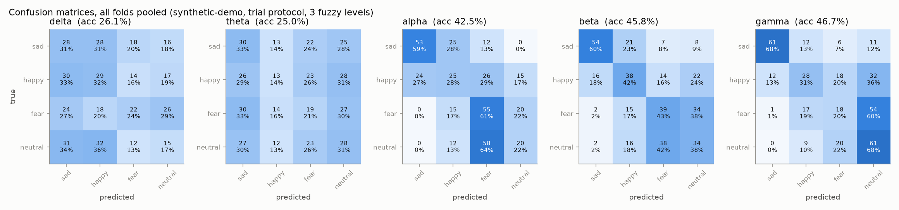
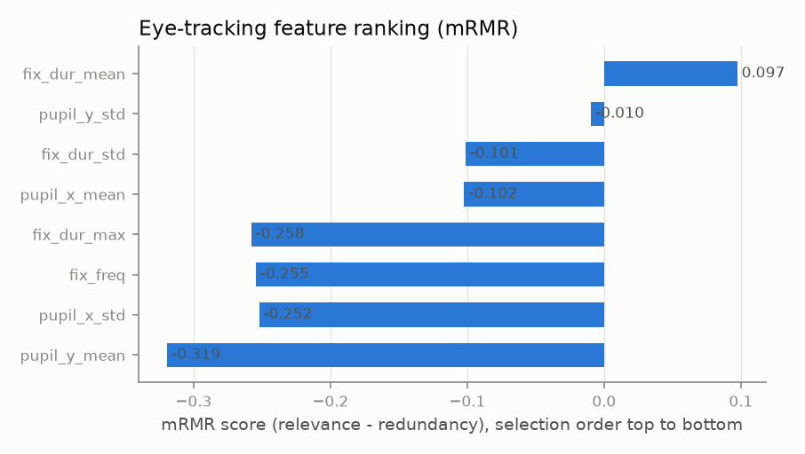
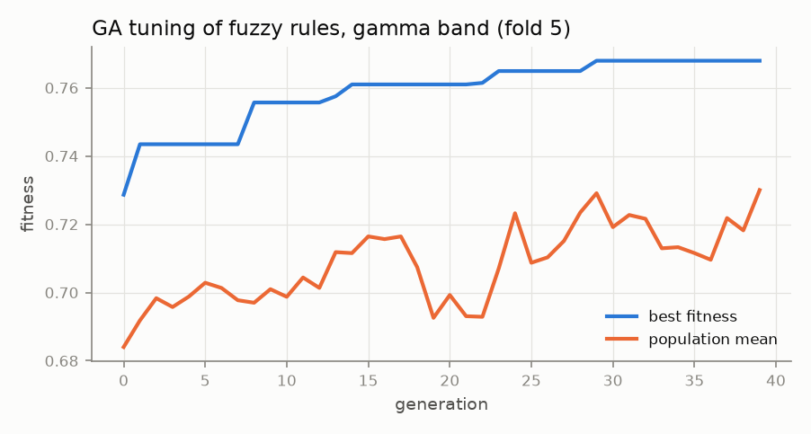
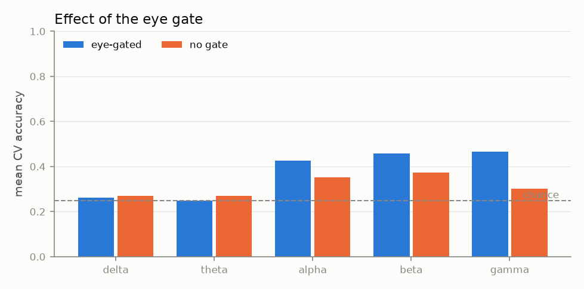
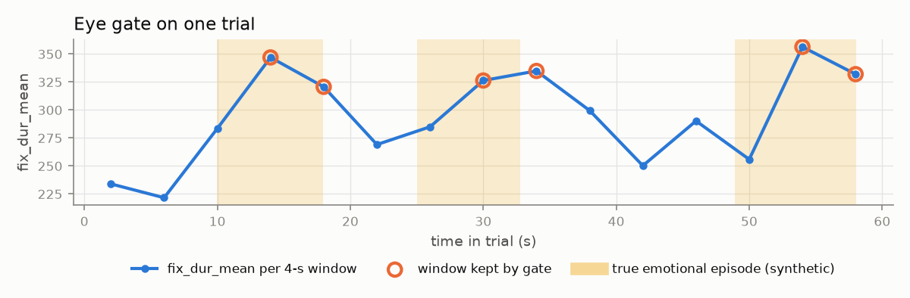
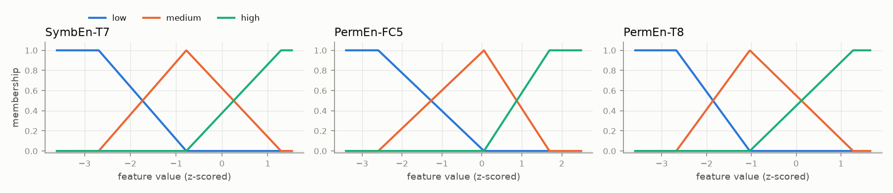
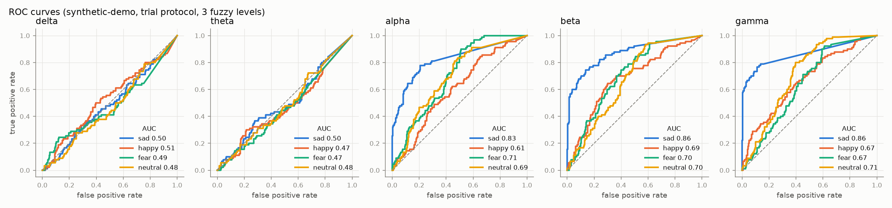

# Results: eye-gated S-FIS-GA emotion recognition

> **Synthetic demo data.** These numbers only show that the pipeline runs and that each stage does what it should. They are not emotion-recognition results and must not be compared with the paper.

- Dataset: `data/demo` (synthetic-demo), classes: sad, happy, fear, neutral
- Windows: 900 total, 360 kept by the eye gate (`fix_dur_mean`, mode `quantile`)
- Protocol: `trial`, 5 folds; features: mRMR on each training fold
- Runtime: 51 s

## Eye-feature ranking (mRMR)

| rank | feature | score |
|---|---|---|
| 1 | fix_dur_mean | 0.0973 |
| 2 | pupil_y_std | -0.0095 |
| 3 | fix_dur_std | -0.1013 |
| 4 | pupil_x_mean | -0.1022 |
| 5 | fix_dur_max | -0.2579 |
| 6 | fix_freq | -0.2545 |
| 7 | pupil_x_std | -0.2522 |
| 8 | pupil_y_mean | -0.3193 |

Gate check against the known synthetic episodes: 39.3% of all windows are inside an episode vs 46.1% of the windows the gate keeps (episode recall 46.9%).

## Accuracy by band and number of fuzzy levels (mean ± std over folds, %)

| band | 3 levels |
|---|---|
| delta | 26.11 ± 4.25 |
| theta | 25.00 ± 2.78 |
| alpha | 42.50 ± 4.78 |
| beta | 45.83 ± 7.08 |
| gamma | 46.67 ± 3.36 |

Best number of levels: **3** (the paper also found 3 best).

## Full metrics, 3 levels

| band | accuracy | macro F1 | macro precision | macro recall (TPR) | macro AUC | lookup table only (no GA) |
|---|---|---|---|---|---|---|
| delta | 26.11 ± 4.25 | 23.32 ± 2.99 | 23.20 ± 2.84 | 26.11 ± 4.25 | 0.495 | 24.17 ± 3.99 |
| theta | 25.00 ± 2.78 | 24.14 ± 3.13 | 25.25 ± 6.08 | 25.00 ± 2.78 | 0.479 | 25.83 ± 5.46 |
| alpha | 42.50 ± 4.78 | 41.12 ± 4.46 | 43.64 ± 4.34 | 42.50 ± 4.78 | 0.709 | 42.78 ± 3.66 |
| beta | 45.83 ± 7.08 | 45.71 ± 6.67 | 47.90 ± 6.60 | 45.83 ± 7.08 | 0.737 | 47.50 ± 6.36 |
| gamma | 46.67 ± 3.36 | 44.71 ± 4.01 | 47.15 ± 3.45 | 46.67 ± 3.36 | 0.727 | 43.61 ± 6.00 |

Per-class (mean over folds):

| band | metric | sad | happy | fear | neutral |
|---|---|---|---|---|---|
| delta | TPR | 0.311 | 0.322 | 0.244 | 0.167 |
| delta | FNR | 0.689 | 0.678 | 0.756 | 0.833 |
| delta | F1 | 0.252 | 0.268 | 0.242 | 0.171 |
| delta | AUC | 0.495 | 0.512 | 0.489 | 0.481 |
| theta | TPR | 0.333 | 0.144 | 0.211 | 0.311 |
| theta | FNR | 0.667 | 0.856 | 0.789 | 0.689 |
| theta | F1 | 0.293 | 0.179 | 0.216 | 0.278 |
| theta | AUC | 0.499 | 0.468 | 0.468 | 0.482 |
| alpha | TPR | 0.589 | 0.278 | 0.611 | 0.222 |
| alpha | FNR | 0.411 | 0.722 | 0.389 | 0.778 |
| alpha | F1 | 0.631 | 0.297 | 0.448 | 0.270 |
| alpha | AUC | 0.826 | 0.606 | 0.711 | 0.692 |
| beta | TPR | 0.600 | 0.422 | 0.433 | 0.378 |
| beta | FNR | 0.400 | 0.578 | 0.567 | 0.622 |
| beta | F1 | 0.653 | 0.411 | 0.408 | 0.356 |
| beta | AUC | 0.859 | 0.689 | 0.704 | 0.695 |
| gamma | TPR | 0.678 | 0.311 | 0.200 | 0.678 |
| gamma | FNR | 0.322 | 0.689 | 0.800 | 0.322 |
| gamma | F1 | 0.741 | 0.353 | 0.206 | 0.489 |
| gamma | AUC | 0.859 | 0.670 | 0.665 | 0.713 |

## Ablations

| band | eye-gated acc | no-gate acc |
|---|---|---|
| delta | 26.11 ± 4.25 | 26.89 ± 0.75 |
| theta | 25.00 ± 2.78 | 27.11 ± 4.60 |
| alpha | 42.50 ± 4.78 | 35.22 ± 3.49 |
| beta | 45.83 ± 7.08 | 37.33 ± 3.27 |
| gamma | 46.67 ± 3.36 | 30.11 ± 5.10 |

Shuffled-label control (gamma band): accuracy 22.78 ± 2.86 (should be near chance, 25%).

## Mined fuzzy rules (3 levels, best fold of each band, ranked by coverage × accuracy × weight)

### delta

| # | rule | coverage | accuracy |
|---|---|---|---|
| 1 | If SampEn-CP4 is medium and SampEn-TP7 is medium and PermEn-PO6 is low then class is happy | 70% | 31.8% |
| 2 | If SampEn-CP4 is low and SampEn-TP7 is medium and PermEn-PO6 is high then class is neutral | 9% | 52.7% |
| 3 | If SampEn-CP4 is high and SampEn-TP7 is low and PermEn-PO6 is low then class is neutral | 41% | 33.9% |
| 4 | If SampEn-CP4 is low and SampEn-TP7 is medium and PermEn-PO6 is medium then class is neutral | 31% | 35.9% |
| 5 | If SampEn-CP4 is high and SampEn-TP7 is high and PermEn-PO6 is low then class is fear | 11% | 47.7% |
| 6 | If SampEn-CP4 is high and SampEn-TP7 is low and PermEn-PO6 is medium then class is sad | 52% | 31.8% |
| 7 | If SampEn-CP4 is low and SampEn-TP7 is medium and PermEn-PO6 is low then class is happy | 24% | 37.4% |
| 8 | If SampEn-CP4 is medium and SampEn-TP7 is high and PermEn-PO6 is medium then class is sad | 15% | 41.2% |
| 9 | If SampEn-CP4 is high and SampEn-TP7 is medium and PermEn-PO6 is medium then class is sad | 61% | 30.5% |
| 10 | If SampEn-CP4 is medium and SampEn-TP7 is medium and PermEn-PO6 is high then class is happy | 22% | 37.1% |

### theta

| # | rule | coverage | accuracy |
|---|---|---|---|
| 1 | If SymbEn-C3 is low and PermEn-F8 is high then class is fear | 15% | 47.2% |
| 2 | If SymbEn-C3 is high and PermEn-TP8 is high and PermEn-F8 is high then class is sad | 4% | 72.7% |
| 3 | If SymbEn-C3 is medium and PermEn-TP8 is low then class is sad | 13% | 46.4% |
| 4 | If SymbEn-C3 is low and PermEn-TP8 is medium and PermEn-F8 is medium then class is fear | 73% | 30.6% |
| 5 | If SymbEn-C3 is low and PermEn-TP8 is low and PermEn-F8 is medium then class is sad | 9% | 50.1% |
| 6 | If SymbEn-C3 is medium and PermEn-TP8 is medium then class is neutral | 92% | 28.8% |
| 7 | If SymbEn-C3 is high and PermEn-TP8 is high and PermEn-F8 is medium then class is sad | 17% | 37.1% |
| 8 | If SymbEn-C3 is medium and PermEn-F8 is medium then class is happy | 92% | 27.3% |
| 9 | If SymbEn-C3 is high and PermEn-TP8 is low and PermEn-F8 is high then class is neutral | 1% | 82.7% |
| 10 | If SymbEn-C3 is high and PermEn-TP8 is medium and PermEn-F8 is high then class is sad | 5% | 41.8% |

### alpha

| # | rule | coverage | accuracy |
|---|---|---|---|
| 1 | If PermEn-T8 is low and PermEn-FT8 is medium and SymbEn-FP2 is low then class is sad | 13% | 96.6% |
| 2 | If PermEn-FT8 is medium and SymbEn-FP2 is low then class is sad | 27% | 65.8% |
| 3 | If PermEn-T8 is low and PermEn-FT8 is medium and SymbEn-FP2 is medium then class is sad | 19% | 70.6% |
| 4 | If PermEn-T8 is medium and PermEn-FT8 is medium and SymbEn-FP2 is medium then class is happy | 89% | 39.5% |
| 5 | If PermEn-FT8 is low and SymbEn-FP2 is medium then class is sad | 24% | 58.9% |
| 6 | If PermEn-T8 is high and PermEn-FT8 is high and SymbEn-FP2 is high then class is neutral | 54% | 42.7% |
| 7 | If PermEn-T8 is medium and PermEn-FT8 is high and SymbEn-FP2 is low then class is sad | 14% | 64.7% |
| 8 | If PermEn-T8 is high and SymbEn-FP2 is medium then class is fear | 75% | 36.9% |
| 9 | If PermEn-T8 is medium and PermEn-FT8 is high and SymbEn-FP2 is high then class is neutral | 57% | 39.0% |
| 10 | If PermEn-FT8 is medium and SymbEn-FP2 is medium then class is happy | 92% | 34.5% |

### beta

| # | rule | coverage | accuracy |
|---|---|---|---|
| 1 | If SymbEn-T8 is low and SampEn-P7 is medium and PermEn-T7 is medium then class is sad | 20% | 93.2% |
| 2 | If SymbEn-T8 is low and PermEn-T7 is medium then class is sad | 20% | 90.9% |
| 3 | If SymbEn-T8 is high and SampEn-P7 is medium and PermEn-T7 is high then class is neutral | 68% | 41.4% |
| 4 | If SymbEn-T8 is low and SampEn-P7 is high and PermEn-T7 is low then class is sad | 6% | 99.4% |
| 5 | If SymbEn-T8 is medium and SampEn-P7 is medium and PermEn-T7 is medium then class is happy | 91% | 36.7% |
| 6 | If SymbEn-T8 is low and SampEn-P7 is high and PermEn-T7 is medium then class is sad | 6% | 95.5% |
| 7 | If SymbEn-T8 is medium and SampEn-P7 is low and PermEn-T7 is medium then class is happy | 63% | 39.5% |
| 8 | If SymbEn-T8 is medium and PermEn-T7 is high then class is fear | 71% | 36.1% |
| 9 | If SymbEn-T8 is high and SampEn-P7 is medium and PermEn-T7 is medium then class is fear | 74% | 35.4% |
| 10 | If SymbEn-T8 is medium and SampEn-P7 is low and PermEn-T7 is high then class is fear | 47% | 37.5% |

### gamma

| # | rule | coverage | accuracy |
|---|---|---|---|
| 1 | If SymbEn-T7 is low then class is sad | 19% | 94.6% |
| 2 | If SymbEn-T7 is low and PermEn-FC5 is medium and PermEn-T8 is medium then class is sad | 16% | 94.5% |
| 3 | If SymbEn-T7 is low and PermEn-FC5 is medium and PermEn-T8 is low then class is sad | 10% | 100.0% |
| 4 | If SymbEn-T7 is high and PermEn-FC5 is medium and PermEn-T8 is high then class is neutral | 75% | 41.5% |
| 5 | If SymbEn-T7 is high and PermEn-FC5 is low and PermEn-T8 is medium then class is fear | 40% | 41.9% |
| 6 | If SymbEn-T7 is medium and PermEn-FC5 is low and PermEn-T8 is high then class is fear | 40% | 40.6% |
| 7 | If SymbEn-T7 is high and PermEn-FC5 is high and PermEn-T8 is high then class is fear | 40% | 39.2% |
| 8 | If SymbEn-T7 is medium then class is happy | 96% | 31.4% |
| 9 | If PermEn-FC5 is low and PermEn-T8 is high then class is fear | 41% | 36.3% |
| 10 | If SymbEn-T7 is medium and PermEn-FC5 is medium and PermEn-T8 is high then class is fear | 81% | 30.7% |

### Best rule per class (all bands)

| class | band | rule | coverage | accuracy |
|---|---|---|---|---|
| sad | beta | If SymbEn-T8 is low and SampEn-P7 is medium and PermEn-T7 is medium then class is sad | 20% | 93.2% |
| happy | alpha | If PermEn-T8 is medium and PermEn-FT8 is medium and SymbEn-FP2 is medium then class is happy | 89% | 39.5% |
| fear | alpha | If PermEn-T8 is high and SymbEn-FP2 is medium then class is fear | 75% | 36.9% |
| neutral | gamma | If SymbEn-T7 is high and PermEn-FC5 is medium and PermEn-T8 is high then class is neutral | 75% | 41.5% |

## Figures

